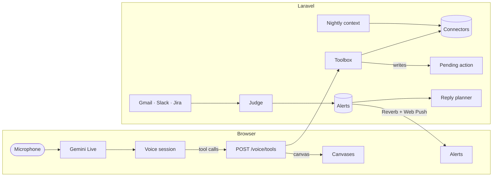

<p align="center">
  <picture>
    <source media="(prefers-color-scheme: dark)" srcset="public/brand/logo-dark.svg">
    
  </picture>
</p>

<p align="center">
  <b>Your workday, spoken.</b><br>
  Tu jornada de trabajo, hablando.<br>
  You talk. It answers out loud and puts on screen the calendar, the email, the thread or the document you are talking about.
</p>

<p align="center">
  <a href="LICENSE"></a>
  
  
  
  
</p>

<p align="center">
  <a href="https://github.com/johnleonkab/sixth-sense">GitHub</a>
  ·
  <a href="#run-it-yourself">Run it yourself</a>
  ·
  <a href="LICENSE">MIT</a>
</p>

---

Sixth Sense is an open-source assistant for a workday you already have. It is not a dashboard and it is not a chatbot with a microphone bolted on. The screen and the voice refer to the same thing, so you can say “open the second one”, “reply to this” or “move it to Thursday”.

You run it. Your Google, Slack, Jira, Notion and GitHub accounts connect to **your** instance. API keys stay on that server, encrypted. Audio goes from the browser to the voice provider and never through Laravel.

The interface speaks Spanish. The code is in English.

## A line you can post

> Sixth Sense es tu jornada de trabajo, hablando. Código abierto (MIT): lo instalas tú, con tus claves, y la pantalla muestra lo mismo que estás diciendo. https://github.com/johnleonkab/sixth-sense

> Your workday, spoken. An open-source assistant that answers out loud and shows the calendar, the email or the thread you mean. Self-host it. https://github.com/johnleonkab/sixth-sense

## What you can ask

> “What do I have today?” · “Find the email where Andrés mentions the contract” · “Reply to everyone that I’ll review it before 12” · “Move it to Thursday and invite Pablo” · “Open the doc Marta sent on Slack” · “Read me the second page” · “What’s waiting on me?”

| | Read and show | Change, always after your “yes” |
|---|---|---|
| **Calendar** | Day and agenda across every calendar you connect | Create meetings with Meet, invite, add a summary, cancel, accept or decline |
| **Gmail** | Search, including “where X says Y”, threads and attachments | Write, reply (one person or everyone) and forward |
| **Docs and Drive** | Search, open with formatting, follow links from mail, events or Slack | Propose edits and comments |
| **Slack** | People, channels, DMs, important unread, threads, files | Messages in a channel or a thread, with mentions |
| **Jira** | Search and open issues | Create and edit issues, set dependencies, comment |
| **Notion** | Search and open pages, comments and links | Create and edit pages, comment and reply |
| **GitHub** | A work archive of notes and agents, on the repository you choose | Propose a file or a deletion; it lands on `main` only after you confirm |
| **Files** | PDF pages, zoom, read aloud, and images | — |

When a decision needs two things, both stay on screen: the draft and the thread, the meeting that does not fit and the day. On a phone they stack.

## It speaks up only when it matters

Sixth Sense watches **Gmail, Slack and Jira** and interrupts you when something is **waiting on you**:

1. **Detects.** New messages pass cheap rules first (newsletters, bots, your own messages), then a model that decides whether you need to answer, and why.
2. **Tells you.** A sound per source, a short note, and a system notification on this phone or computer. The alert stays until you deal with it.
3. **Proposes.** A separate planner drafts a way through: “Reply to everyone that we can’t make it, and offer Thursday”, with the draft and the meeting ready to confirm.
4. **You review it by voice.** Say “tell me”, change what you want, and confirm each action.
5. **Closes itself** once you have replied, from here or from Gmail, Slack or Jira.

It also warns you before a **meeting**: up to 30 minutes ahead when there is something to prepare, and a couple of minutes ahead when there is not.

Install the site to your home screen and turn on **Avisar en este dispositivo**. Opening the notification lands you on that alert.

## It knows what you are in the middle of

Turn on **Configuración → Contexto** and, each night, Sixth Sense reads the week in **read-only** mode: recent Slack, Gmail, Google Docs and Notion. It writes a short brief of the workstreams, why they matter, who is involved, and what is still open. The assistant reads that brief at the start of each conversation, so “the prepayment thing” or “Marta’s doc” already means something. Older than three days, it stops using it. You can read the brief and rebuild it from the same screen.

A GitHub repository can hold the longer archive: the notes and the agents for that work. You edit them from settings or by voice. Writes wait for a yes, and they go to `main`.

## In a Google Meet call

[Wingman](extensions/wingman-meet) is a small browser extension. It reads Meet’s own captions on your screen. No bot joins the call. During the meeting it can surface the ticket you just named, a slot that is free, or a message you promised to send. When you hang up, what you committed to is waiting as actions you can confirm. Transcripts are discarded once the notes exist.

## Principles

- **Voice first.** The keyboard is there: click the line of what you are saying and type.
- **The screen is what you are talking about.** At most two columns.
- **Two lines of text.** What you are saying, and what it answers. No chat history.
- **Reading is free. Writing always asks for a “yes”.** You see the draft first. After you confirm, you have 8 seconds to undo.
- **Several accounts from the start.** More than one Google, Slack, Jira or Notion account. Reads join them.
- **Quiet on purpose.** One typeface, one accent colour, light and dark.

## How it is built



- **Laravel never handles audio.** The browser talks to the voice provider with a short-lived token.
- **Voice is Gemini Live.** Other text (alerts, drafts, context, Wingman, the scheduler) goes through DeepSeek by default, or Gemini if you set `AI_TEXT_PROVIDER`.
- **Each tool lives once** in `app/Voice/Tools` and returns words for the model plus, when it should, a canvas the frontend already knows how to paint.
- **Each service lives in its connector** (`app/Connectors`), with a fake for tests and for demo mode.
- **Your keys or the server’s.** A signed-in person can store their own Gemini and DeepSeek keys. They are encrypted, and a background job forgets them when it finishes.

## Run it yourself

**You need** Docker and Node. PHP and Composer run inside the `app` container.

```bash
git clone https://github.com/johnleonkab/sixth-sense.git
cd sixth-sense
cp .env.example .env

docker compose build app
docker compose run --rm app composer install
docker compose run --rm app php artisan key:generate
npm install

docker compose up -d
docker compose exec app php artisan migrate
docker compose exec app php artisan app:create-user
```

Then, one terminal each:

```bash
docker compose exec app php artisan horizon
docker compose exec app php artisan reverb:start
docker compose exec app php artisan schedule:work
npm run dev
```

Open **http://localhost:8000**, sign in, and press **Hablar**.

With PHP 8.5 on the machine, `php artisan …` and `composer run dev` work without the `docker compose exec app` prefix.

Set `CONNECTORS_DEMO=true` to click through with the sample data from `docs/prototype.html`, before any account is connected.

### What to fill in

| Variable | What it is |
|---|---|
| `GEMINI_API_KEY` | Voice. Create one in [Google AI Studio](https://aistudio.google.com/apikey). |
| `GEMINI_LIVE_MODEL`, `GEMINI_LIVE_VOICE` | Conversation model and voice. |
| `AI_TEXT_PROVIDER` | `deepseek` (default) or `gemini`, for everything that is not the live voice. |
| `DEEPSEEK_API_KEY` | Text key, from [DeepSeek](https://platform.deepseek.com/api_keys). |
| `GOOGLE_CLIENT_ID`, `GOOGLE_CLIENT_SECRET`, `GOOGLE_REDIRECT_URI` | A Google Cloud web client, with Calendar, Gmail, Docs and Drive enabled. |
| `SLACK_CLIENT_ID`, `SLACK_CLIENT_SECRET`, `SLACK_REDIRECT_URI` | A Slack app with user token scopes. The redirect has to be HTTPS, so local development uses a tunnel. |
| `ATLASSIAN_CLIENT_ID`, `ATLASSIAN_CLIENT_SECRET`, `ATLASSIAN_REDIRECT_URI` | Jira. |
| `NOTION_CLIENT_ID`, `NOTION_CLIENT_SECRET`, `NOTION_REDIRECT_URI` | A public Notion integration. |
| `GITHUB_CLIENT_ID`, `GITHUB_CLIENT_SECRET`, `GITHUB_REDIRECT_URI` | The archive. GitHub must be allowed to issue a refresh token. |
| `VAPID_PUBLIC_KEY`, `VAPID_PRIVATE_KEY`, `VAPID_SUBJECT` | Web Push. The public key is given to the browser. `VAPID_SUBJECT` should be a `mailto:` you actually read. |
| `REGISTRATION_ENABLED` | `true` lets anyone create an account from the sign-in screen. Off by default; use `app:create-user`. |
| `CONNECTORS_DEMO` | `true` uses sample data instead of live accounts. |

People connect accounts in **Configuración → Conexiones**, choose sounds in **Configuración → Avisos**, and turn the nightly brief on in **Configuración → Contexto**. Their own model keys, if they prefer them to the server’s, go in **Configuración → Sistema**.

### Useful commands

```bash
docker compose exec app php artisan alerts:watch
docker compose exec app php artisan alerts:check-replies
docker compose exec app php artisan alerts:test you@email.com
docker compose exec app php artisan chats:warm
docker compose exec app php artisan context:build
```

## Tests

```bash
npm run build
docker compose exec app php artisan test --compact
```

Pest covers each tool, connector, alert and pending action. Nothing in the suite calls a live service.

## Layout

```
app/
├── Actions/        Changes waiting for “yes”, “cancel”, “undo”
├── Alerts/         Watchers, the judge, reply drafts, meeting reminders, Web Push
├── Connections/    Connected accounts, OAuth, tokens
├── Connectors/     Google, Slack, Jira, Notion and GitHub, each with a fake
├── Scenes/         Asks that take more than one step, shown as they run
├── Sense/          The work archive on GitHub
├── Voice/          Voice provider, the assistant, and tools
└── WorkContext/    The nightly read-only brief
resources/js/
├── canvas/         One view per kind of thing on screen
├── voice/          The voice session
└── pages/          The assistant, the landing, and settings
extensions/wingman-meet/   The Meet extension
```

## License

[MIT](LICENSE). Use it, change it, run it for yourself, and send a pull request if you want to.

<p align="center"><sub>Made with voice, Laravel, and a lot of white space.</sub></p>
