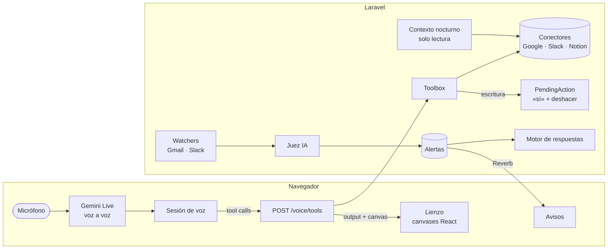

<p align="center">
  <picture>
    <source media="(prefers-color-scheme: dark)" srcset="public/brand/logo-dark.svg">
    
  </picture>
</p>

<p align="center">
  <b>Tu jornada de trabajo, hablando.</b><br>
  Hablas; la IA te responde con voz y, a la vez, pone en pantalla justo lo que hace falta.
</p>

<p align="center">
  
  
  
  
  
  
  
</p>

---

Sixth Sense no es un dashboard ni un chatbot con voz. Es una **pantalla compartida**: lo que se dice y lo que se ve se refieren a lo mismo. Le pides «enséñame mañana», «abre el email de Marta», «contesta a este» o «pasa a la página 3», y la IA habla y muestra el calendario, el email, el hilo de Slack o el PDF del que estáis hablando.

Conecta con **Google Calendar, Gmail, Google Docs, Google Drive, Slack y Notion**, con todas las cuentas que quieras de cada uno.

## Qué se le puede pedir

> «¿Qué tengo hoy?» · «Busca el email donde Andrés habla del contrato» · «Contéstale a todos que lo reviso antes de las 12» · «Muévela al jueves e invita a Pablo» · «Abre el documento que me ha pasado Marta por Slack» · «Léeme la segunda página» · «¿Qué tengo pendiente de responder?» · «Dime»

| | Leer y mostrar | Cambiar (siempre con tu «sí») |
|---|---|---|
| **Calendar** | Día y agenda de todos tus calendarios; buscar eventos | Crear reuniones con Meet, invitar, añadir resumen, cancelar, aceptar o rechazar |
| **Gmail** | Búsqueda con expresiones regulares («donde X dice Y»), resultados y detalle, adjuntos | Redactar, responder (a uno o a todos) y reenviar |
| **Docs y Drive** | Buscar, abrir con formato, abrir los enlazados desde emails, eventos o Slack, archivos de Word | Proponer ediciones y comentarios |
| **Slack** | Personas, canales y DMs, no leídos importantes, hilos, archivos | Mensajes en conversaciones o hilos, con menciones |
| **Notion** | Buscar y abrir páginas, sus comentarios y enlaces | Crear y editar páginas, comentar y responder comentarios |
| **Archivos** | Visor de PDF (páginas, zoom, leer en voz alta) e imágenes | — |

## Proactiva, con criterio

Sixth Sense vigila **Gmail y Slack** y solo te interrumpe cuando algo **espera tu respuesta**:

1. **Detecta**: los mensajes nuevos pasan primero por unas reglas baratas (newsletters, bots, tus propios mensajes) y después por un juez de IA que decide si te toca responder y **por qué**.
2. **Te avisa** con un sonido propio de cada fuente y una nota breve. La alerta queda **pendiente** hasta que respondes, aunque recargues.
3. **Propone**: un motor de respuestas independiente piensa cómo resolverla. Por ejemplo: «Responder a todos que no llegamos y proponer el jueves», con borrador y otras acciones como crear el evento.
4. **La revisas hablando**: dices «dime», cambias lo que quieras y la IA prepara cada acción para que la confirmes.
5. **Se cierra sola** cuando respondes, ya sea desde aquí o desde Gmail o Slack.

También avisa antes de cada **reunión**: hasta 30 minutos antes si hay que preparar algo, y un par de minutos antes si no.

## Sabe en qué estás

Si activas **Configuración → Contexto**, cada noche Sixth Sense repasa tu semana **en modo solo lectura**:

- **Slack**: los últimos 5 días de lo que escribes, lo que te escriben y donde te mencionan.
- **Gmail**: 7 días de la bandeja principal y de enviados.
- **Google Docs y Notion**: los documentos y páginas que se han creado, compartido o editado en 7 días.

Con eso escribe un contexto breve: en qué procesos estás, por qué, con quién y dónde, y qué tienes pendiente. El asistente lo lee al empezar cada conversación, así que entiende «lo del prepago» o «lo de Marta» sin que se lo expliques, y no añade ninguna llamada ni retraso. En la misma pantalla ves su estado, lo que sabe el asistente y un botón para regenerarlo. Si tiene más de 3 días, el asistente deja de usarlo.

## Principios

- **Voz primero.** Todo se puede hacer hablando. El teclado es solo una alternativa: haz clic en la línea de tu voz para escribir.
- **La pantalla es lo que hablas.** El agente decide qué mostrar, con un máximo de dos columnas.
- **Solo dos líneas de texto**: lo que dices y lo que responde. No hay historial de chat.
- **Leer es libre; escribir siempre pide un «sí».** Todo cambio se muestra antes como borrador y, una vez confirmado, tienes 8 segundos para deshacerlo.
- **Multicuenta desde el principio.** Puedes conectar varias cuentas de Google o de Slack, y las lecturas las juntan.
- **Diseño limpio.** Una tipografía, un color de acento, modo claro y oscuro.

## Arquitectura



- **Laravel nunca toca el audio.** El navegador habla directamente con el proveedor de voz usando un token efímero que emite Laravel.
- **Proveedor de voz intercambiable**, detrás de `VoiceProvider` (PHP) y `VoiceTransport` (TS). Hoy es Gemini Live.
- **Herramientas declaradas una sola vez** en `app/Voice/Tools` y traducidas al formato de cada proveedor. Cada una devuelve `output` para el modelo y, si procede, un **canvas**: una vista preconfigurada que el frontend sabe pintar (`calendar.day`, `mail.message`, `pdf.viewer`, `alerts.review`…).
- **Toda la lógica de un servicio vive en su conector** (`app/Connectors`), cada uno con un `Fake` para los tests y para el **modo demo**.
- **Texto intercambiable** tras `TextModel` (`AI_TEXT_PROVIDER`). Alertas, borradores, contexto, agenda y Wingman usan DeepSeek por defecto. La voz no pasa por ahí.
- **Motor de respuestas aislado** tras `ReplyPlanner`. Se puede sustituir por otro agente con acceso a tu base de conocimiento.
- **Contexto de trabajo** tras `ContextSummarizer`: un job nocturno lee la semana con los conectores (solo métodos de lectura), el modelo de texto la resume, y el resultado se añade a las instrucciones de cada sesión de voz.

## Puesta en marcha

**Requisitos:** Docker y Node. PHP y Composer se ejecutan dentro del contenedor `app`, así que no hace falta instalarlos.

```bash
git clone git@github.com:johnleonkab/sixth-sense.git && cd sixth-sense
cp .env.example .env

docker compose build app
docker compose run --rm app composer install
docker compose run --rm app php artisan key:generate
npm install

docker compose up -d                                   # app :8000, Reverb :8080, Postgres :5433, Redis :6380
docker compose exec app php artisan migrate
docker compose exec app php artisan app:create-user    # te pide nombre, email y contraseña
```

Para trabajar, en cuatro terminales:

```bash
docker compose exec app php artisan horizon            # colas
docker compose exec app php artisan reverb:start       # avisos en tiempo real
docker compose exec app php artisan schedule:work      # tareas programadas (avisos, contexto nocturno)
npm run dev                                            # Vite, en tu máquina
```

> Con PHP 8.5 instalado en tu máquina puedes usar `php artisan …` y `composer dev` directamente, en vez de `docker compose exec app …`.

Abre **http://localhost:8000**, entra con tu usuario y pulsa **Hablar**.

> **Sin cuentas conectadas:** con `CONNECTORS_DEMO=true` todo funciona con los datos de ejemplo del prototipo (`docs/prototype.html`).

### Configuración

| Variable | Para qué |
|---|---|
| `GEMINI_API_KEY` | Voz (Gemini Live) y las muestras de voz. Se obtiene en [Google AI Studio](https://aistudio.google.com/apikey). |
| `GEMINI_LIVE_MODEL`, `GEMINI_LIVE_VOICE` | Modelo y voz de la conversación. |
| `AI_TEXT_PROVIDER` | Quién escribe el texto que no es voz: `deepseek` (por defecto) o `gemini`. |
| `DEEPSEEK_API_KEY` | Clave del texto. Se obtiene en [DeepSeek](https://platform.deepseek.com/api_keys). |
| `DEEPSEEK_MODEL`, `DEEPSEEK_LIGHT_MODEL` | Modelo capaz (respuestas, contexto, Wingman) y modelo ligero (juez de alertas y reuniones). |
| `WORK_CONTEXT_RUN_AT` | Hora a la que se genera el contexto de trabajo cada noche (por defecto `04:30`). |
| `GOOGLE_CLIENT_ID`, `GOOGLE_CLIENT_SECRET`, `GOOGLE_REDIRECT_URI` | Cliente OAuth web de Google Cloud, con las APIs de Calendar, Gmail, Docs y Drive activadas. |
| `SLACK_CLIENT_ID`, `SLACK_CLIENT_SECRET`, `SLACK_REDIRECT_URI` | App de Slack con *user token scopes*. La redirección debe ser HTTPS, así que en local se usa un túnel. |
| `NOTION_CLIENT_ID`, `NOTION_CLIENT_SECRET`, `NOTION_REDIRECT_URI` | Integración pública de Notion. |
| `REGISTRATION_ENABLED` | `true` para que cualquiera pueda crearse una cuenta desde la pantalla de entrada. Por defecto está apagado y las cuentas se crean con `app:create-user`. |
| `CONNECTORS_DEMO` | `true` para usar datos de ejemplo en lugar de las cuentas reales. |

Las cuentas se conectan desde **Configuración → Conexiones**, los avisos se activan por fuente en **Configuración → Avisos**, y el contexto nocturno en **Configuración → Contexto**.

### Comandos útiles

```bash
docker compose exec app php artisan alerts:watch                # comprueba Gmail y Slack ahora (el scheduler lo hace cada minuto)
docker compose exec app php artisan alerts:check-replies        # resuelve las alertas que ya has respondido
docker compose exec app php artisan alerts:test tu@email.com    # lanza una alerta de prueba en tu propio DM de Slack
docker compose exec app php artisan chats:warm                  # precarga personas y canales de Slack
docker compose exec app php artisan context:build               # genera ahora el contexto de trabajo (el scheduler lo hace cada noche)
```

## Tests

```bash
npm run build                                   # los tests de páginas necesitan el manifest de Vite
docker compose exec app php artisan test --compact
```

Hay tests de Pest para cada herramienta, conector, alerta y acción. Ninguno llama a servicios reales: todos usan `Http::fake()` o el `Fake` del conector.

## Estructura

```
app/
├── Actions/        Cambios pendientes de confirmar: «sí», «cancela», «deshaz»
├── Alerts/         Watchers, juez, motor de respuestas, recordatorios de reuniones
├── Connections/    Cuentas conectadas, OAuth, capacidades y tokens
├── Connectors/     Google (Calendar, Gmail, Docs, Drive), Slack y Notion, con sus Fakes
├── Voice/          Proveedor de voz, perfil del asistente y herramientas
└── WorkContext/    Contexto nocturno: lectura de la semana y resumen
resources/js/
├── canvas/         Una vista por tipo de contenido (calendario, email, Slack, PDF…)
├── voice/          Sesión de voz, transporte, memoria y audio
└── alerts/         Avisos en tiempo real y sonidos (Web Audio)
```

## Próximamente

- Jira.
- Dos columnas de contenido a la vez.
- Que la IA pueda ver las imágenes que se le muestran.
- Un motor de respuestas con acceso a la base de conocimiento.

<p align="center"><sub>Hecho con voz, Laravel y mucho espacio en blanco.</sub></p>
