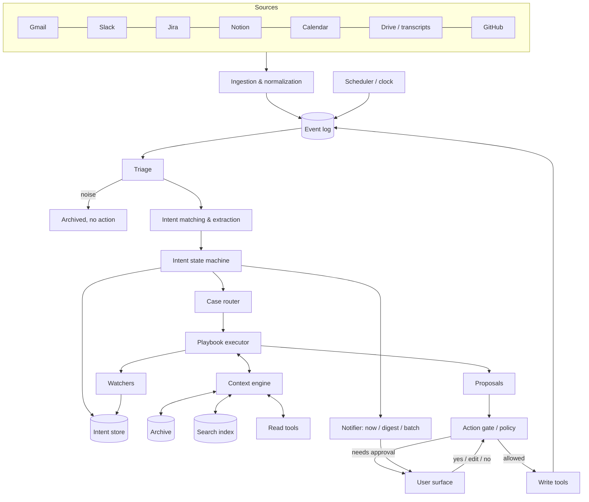

# sixth-sense — High-level architecture

How the system is built to handle the cases in `communication-cases.md`.
This document covers components, data, flows and how models are used. It does not cover
implementation details (languages, hosting, exact providers).

---

## 1. Design principles

1. **State lives in code, judgment lives in models.** Intents, watchers, deadlines and permissions are
   stored and changed by deterministic code. Models read, classify, match, extract and draft. A model
   *proposes* a state change. Code validates it and applies it.
2. **Cheap first, expensive only when needed.** Most messages are noise or simple updates. They should
   never reach a large model. Escalate by need, not by default.
3. **Everything external is a proposal.** Write actions go through one gate. The gate decides from a
   policy written in code, not from a model's opinion.
4. **Reading leaves no trace.** Ingestion never marks things read, reacts, or resolves anything.
5. **Every claim has a source.** Anything a model says about the product, a person or a past
   conversation carries a reference to where it came from. No reference, no confidence.
6. **Cases are data, not code paths.** The 62 cases map to a small set of reusable playbooks.
   Adding a case should mostly mean writing a playbook definition, not new code.
7. **Replayable.** Every input event is stored. The whole state can be rebuilt by replaying events,
   which is also how the system is tested.

---

## 2. Overview

---

## 3. Components

### 3.1 Ingestion & normalization

- One connector per source. Webhooks where available (Slack events, Jira webhooks, Gmail push,
  Calendar push, GitHub webhooks). Polling as fallback and for reconciliation.
- **Read-only credentials for ingestion**, separate from the credentials used by write tools.
  Endpoints with read side effects are not used.
- Every event is normalized into a **Message** (see data model): who, to whom, channel, thread,
  timestamp, text, attachments, links, direction (incoming / outgoing).
- Outgoing messages from the user are ingested too. They are where the user's own commitments come from.
- Non-message events become typed events: ticket status changed, PR merged, calendar event created,
  transcript available, file shared.
- Dedupe by source id. Store raw payload plus normalized form in the event log.

### 3.2 Event log

- Append-only. Every source event, every clock tick, every model decision, every user answer,
  every action taken.
- It is the audit trail, the undo source, and the replay source for tests.

### 3.3 Scheduler / clock

Emits time events into the same log, so time-based cases go through the same pipeline as messages:

- Watcher deadlines (cases 5, 8, 16, 24).
- Staleness sweeps over open intents.
- Calendar look-ahead: meetings about to start (14, 53, 54), planning and releases ahead (43, 51),
  recurring reports (30).
- Digest times (start and end of day).

### 3.4 Triage

First stage for every message. Small, fast model plus rules.

- **Rules first:** known automated senders, newsletters, CC-only, own messages to self, bots.
  Some automated messages are allow-listed as deliveries or asks (case 28).
- **Model classifies** what is left into: noise / possible intent / possible signal / urgent / sensitive.
- **Sensitive** (case 32) sets a flag that follows the message everywhere: restricted tools,
  no autonomy, no quoting into shared places.
- **Urgent** (cases 21, 35, 45) skips batching and goes straight to the notifier after processing.

Goal: drop most traffic here. Measure the drop rate and the miss rate.

### 3.5 Intent matching & extraction

For anything triage did not drop. Two steps:

1. **Candidate retrieval (no model reasoning):** open intents and recently settled intents that share
   participants, thread ids, linked tickets or pages, or are close in embedding space.
   Keep it to a short list (around 10).
2. **Match and extract (mid-size model, structured output):** given the message and the candidates,
   return a list of operations:
   - `attach(intent_id)` — continues an open intent
   - `open(new intent)` — with what, requester, responder, deadline if stated
   - `settle(intent_id, reason)`
   - `reopen(intent_id)`
   - `update(intent_id, fields)` — new deadline, new responder (delegation), etc.
   - `signal(about intent_id or owned area)`
   - `noise`
   Each operation carries a confidence and the quote from the message that justifies it.

Low confidence on a match → attach to the most likely intent, flag it as uncertain, show the
correction option in the user surface. Merges and splits are user actions that become events.

### 3.6 Intent state machine

Deterministic code. Applies the operations from 3.5 if they are valid:

- States: `open`, `settled`, `stale`, `expired` (low-importance asks that timed out).
- Validates transitions (cannot settle what is not open, cannot reopen what was never settled).
- Computes **importance** from rules and archive data: who is involved, blocked dependents,
  deadline distance, repetitions across channels (case 10), production / client / money flags.
- Emits **state change events**. Only state changes move the pipeline forward, never raw messages.
  This is how "react when the state changes, not when a message arrives" is enforced.

### 3.7 Case router

Maps a state change (or a time event) to one or more **playbooks**.

- First pass is rules on structured fields: source type, event type, direction, who the requester is,
  whether the user is responder, flags.
- Ambiguous cases go to a small model that picks from the list of playbooks, given the intent summary.
- A state change can trigger more than one playbook (a release bug is both "QA bug" and
  "release readiness").
- Many state changes trigger nothing except updating the store.

### 3.8 Playbooks

A playbook is a declarative definition. The 62 cases group into roughly these playbooks:

| Playbook | Cases |
|---|---|
| Answer from sources | 1, 9, 19, 23, 37, 60 |
| Clarify then answer | 2, 34, 47 |
| Prepare work + block time | 3, 8, 12, 46, 61 |
| Rebuild context for user | 4 |
| Watch and follow up | 5, 6, 26, 38, 39, 50 |
| Do what the user promised | 7, 55 |
| Close the loop | 15, 22, 41, 44 |
| Dependency risk | 16, 24, 29, 59 |
| Contradiction / conflict | 17, 35, 36, 40, 56 |
| Signal to digest | 18, 27, 33, 49 |
| Pattern detection | 20, 48 |
| Incident | 21, 42, 45 |
| Transcript processing | 11, 52, 57 |
| Briefing | 13, 14, 51, 53, 54 |
| Recurring draft | 30, 43 |
| Redirect | 25 |
| Away mode | 31 |
| Onboard person | 58 |
| Approval request | 62 |

Each playbook definition contains:

- **Trigger:** which events / state changes.
- **Context needed:** which sources to read (conversation, tickets, repos, calendar, archive).
- **Steps:** built from the shared building blocks: Gather → Resolve → Ask user → Propose → Act → Watch.
- **Allowed actions:** which write tools it may propose.
- **Model tier per step.**
- **Output:** questions for the user, proposals, new intents, new watchers.

### 3.9 Playbook executor

Runs a playbook as a bounded agent loop:

- Has the read tools listed in the playbook, a step budget, a token budget and a time budget.
- Produces only structured outputs: `question`, `proposal`, `new_intent`, `watcher`, `finding`.
  It cannot call write tools directly. Writes only exist as proposals.
- Long-running playbooks (chained cases) persist their state between steps. When they wait for
  someone (the designer's doubts in case 2, the user filling the Notion page in case 3), they stop and
  resume from a watcher event. They do not keep a model session open.

### 3.10 Context engine

Everything a playbook reads goes through here, so retrieval is consistent and cited.

- **Conversation assembly:** all messages linked to an intent, across channels, in order.
- **Search index:** embeddings plus keyword search over messages, Notion, Jira, Drive docs, and code
  (repos indexed by file and symbol, refreshed on push).
- **Live read tools:** for fresh state (current ticket status, calendar free/busy, latest commit).
- **Archive:** people (role, team, relationship to the user, importance), what the user owns
  (products, epics, areas), user preferences (working hours, focus time, tone). Read by many,
  written only by explicit user actions and a few playbooks (case 58, 59) through proposals.
- **Source precedence rules** (code = what is built, Jira/Notion = what was decided, recent beats old)
  are applied here, and conflicts are returned as findings, not resolved silently.

### 3.11 Action gate / policy engine

The only path to write tools.

- **Policy is code, configured by the user:** per action class (send message, comment on ticket,
  create calendar event, edit calendar event, share file, edit Notion page...) × context
  (to whom, sensitive flag, internal / external, reversible or not).
- Outcomes: `allow` (and report with undo), `ask` (default), `deny`.
- Hard denies regardless of configuration: sensitive-flagged actions, anything to clients unless asked,
  product answers sent without review, commitments to dates.
- Every allowed action records how to undo it when possible.

### 3.12 Write tools

Thin wrappers over source APIs: send Slack message, reply to email, comment on Jira, edit Notion,
create / update calendar event, share Drive file. Idempotent by proposal id, so a retried action
never sends twice. Results go back into the event log, and get ingested like any other message.

### 3.13 Watchers

A watcher is an intent with a machine-checkable condition and a deadline.

- **Condition types:** a reply on any channel in the conversation; a specific event (email from X
  matching Y, ticket moves to Z, page edited, PR merged); a user action (slot passed, page filled).
- Conditions are checked on each relevant event (cheap, mostly rules), and on deadline by the clock.
- When the condition is ambiguous ("is this email the invitation?"), a small model decides.
- On fire: resume the parent playbook, or run its follow-up step.

### 3.14 Notifier

Decides **when** the user hears about something:

- **Now:** urgent flag, high-importance intent where the user just became responder, a commitment
  of the user's about to fail.
- **Digest:** everything else ready for the user (questions, proposals, signals).
- **Batch:** stale intents, low-priority patterns.
Respects focus time and working hours from the archive, except for urgent.

### 3.15 User surface

Where the user sees and answers. Independent of the channels it tracks.

- **Inbox of items:** questions, proposals, signals, with source links. Each item is answerable in one action:
  approve, edit, reject, choose an option, dictate a reply.
- **Intent view:** open intents grouped as "waiting on me" / "I'm waiting on" / "stale".
  Corrections: re-match, merge, split, close, change importance.
- **Digest:** start and end of day.
- Every correction is an event. Corrections are the main training and evaluation signal.

---

## 4. Data model (core entities)

| Entity | Key fields |
|---|---|
| **Message** | id, source, channel/thread ref, author, recipients, direction, timestamp, text, links, flags (sensitive, automated) |
| **Intent** | id, what (one sentence), requesters, responders, deadline, state, importance, parent (intent / event / transcript), last change (message ref + summary), match confidence |
| **ConversationLink** | intent_id, message_id, operation that linked it, confidence |
| **Watcher** | id, intent_id, condition, deadline, on_fire (playbook step), state |
| **Signal** | id, message_id, about (intent or owned area), importance, shown_at |
| **PlaybookRun** | id, playbook, trigger event, state, step, persisted context refs, budgets used |
| **Proposal** | id, run_id, action class, target, payload, sources, status (pending / approved / edited / rejected / executed / undone) |
| **Question** | id, run_id, text, context, options, answer |
| **Person** (archive) | id, identities per source, role, team, relation to user, importance |
| **OwnedArea** (archive) | products, epics, repos, Notion spaces the user is responsible for |
| **Policy** | action class, conditions, outcome |
| **Event** | id, type, payload, timestamp, causation id (what caused it) |

Identity resolution (the same person across Slack, Gmail, Jira, GitHub) lives in Person and is
needed before matching works well. Build it early.

---

## 5. Model usage

### 5.1 Tiers

| Tier | Used for | Why |
|---|---|---|
| **Rules / no model** | dedupe, known senders, thread-id matching, policy, state transitions, watcher conditions that are exact | free and deterministic |
| **Embeddings** | candidate retrieval for matching, search index, pattern detection (cases 20, 48) | cheap similarity |
| **Small / fast** | triage, routing ambiguous cases, simple watcher conditions, short summaries | high volume, low stakes |
| **Mid** | intent matching and extraction, action point extraction, context summaries for the user, most drafts | the core loop, needs reliability in structured output |
| **Large / reasoning** | answering from code and specs (1, 9, 40), contradictions and conflicts (17, 36, 56), transcript analysis (11), anything sent to others that states product facts | low volume, high stakes |

### 5.2 Harness rules

- **Model router:** each call declares a task type, not a model. A config maps task types to model
  tier and provider, with a fallback per task. Swapping providers is a config change.
- **Structured outputs everywhere.** Every model call has a schema. Invalid output is retried once,
  then escalated a tier, then turned into a question for the user.
- **Escalation by confidence.** A small or mid model that returns low confidence hands the same task
  to the next tier, with its own output as a hint.
- **Verification before external sends.** Drafts that state facts and go to other people are checked
  by a second pass (different model or different prompt): every claim must map to a cited source.
  Unsupported claims are removed or turned into questions for the user.
- **Prompts are versioned** alongside playbooks. Every model call logs prompt version, model, input refs,
  output, cost and latency.
- **Budgets:** per message, per playbook run, per day. When the budget is hit, the system degrades to
  "show the user, no drafting" instead of failing silently.
- **Caching:** conversation summaries and code-area summaries are cached and refreshed on change, so
  the large model gets compact context, not raw history.

---

## 6. Main flows

### 6.1 Incoming message

1. Connector receives it → normalize → event log.
2. Triage: drop noise, flag sensitive / urgent.
3. Retrieve candidate intents → match & extract operations.
4. State machine applies valid operations, recomputes importance, emits state changes.
5. Router picks playbooks for the state changes. If none, stop.
6. Executor runs playbooks with context engine, produces questions / proposals / watchers.
7. Notifier delivers them now or in the digest.
8. User answers → gate → write tools → result back to the event log.

### 6.2 Time event

1. Scheduler emits event (watcher deadline, meeting ahead, staleness sweep).
2. Router picks the playbook (follow-up, briefing, stale batch...).
3. Same executor → notifier → user → gate path.

### 6.3 Chained case (example: case 3, boss asks for data)

1. Message → intent opened (boss requester, user responder, deadline if any).
2. Playbook "Prepare work + block time": structure request, create Notion page draft (proposal),
   find slots (calendar read), propose slot or propose asking for more time.
3. User approves → page created, time blocked. Watcher created: "page filled".
4. Run pauses.
5. Page edited → watcher condition checked → fires → playbook resumes → proposal: "share it with your boss?"
6. User approves → message sent → intent settled when the boss acknowledges, or when sent if
   that is enough.

---

## 7. Safety and privacy

- Separate credentials for read and write. Least privilege per connector.
- Sensitive flag restricts tools, disables autonomy, and keeps content out of shared places and out of
  logs that leave the system.
- Content from messages, documents and code is data. Instructions found inside them are never
  followed. Playbooks get no tools that act on such instructions without a user proposal.
- Undo for every reversible action. Audit for every action.
- Data retention policy for raw messages, separate from the intent store (which keeps only summaries
  and references).

---

## 8. Evaluation

- **Golden set:** for each of the 62 cases, a few realistic event sequences with the expected
  intents, state changes, and outputs. Run on every change to prompts, models or playbooks.
- **Replay:** run a real week of the user's events through the system and compare with what the user
  actually did.
- **Live metrics:**
  - Triage: share dropped, misses (things the user later marked important).
  - Matching: corrections per 100 messages (re-match, merge, split).
  - Interrupt quality: "now" notifications the user marked as not urgent.
  - Proposals: acceptance rate, edit size, rejection reasons.
  - Answers: claims later found wrong.
  - Cost and latency per message and per playbook.

---

## 9. Build order

1. Ingestion for Slack and Gmail, event log, identity resolution, read-only.
2. Triage + matching + state machine + intent view. No playbooks yet. Validate that the intent list
   matches what the user has in mind.
3. Watchers + scheduler + notifier (cases 5, 6, 26, stale batch). High value, low risk.
4. Action gate + write tools + user surface with approvals.
5. Context engine with Jira, Notion and GitHub. Playbooks "Answer from sources" and
   "Rebuild context" (cases 1, 4, 9).
6. Calendar + Drive. Transcripts, briefings, prepare-work playbooks.
7. The rest of the playbooks, in order of how often the cases occur in the user's real traffic.

---

## 10. Open decisions

- Whether messages to other people sent by the system go out as the user or signed as an assistant.
- Which action classes the user pre-approves (and default policy for new users).
- Where the user surface lives: its own app, a Slack DM with the system, or both.
- How long raw messages are kept.
- Single tenant (one user) or multi-user from the start. Multi-user changes identity, archive and
  policy storage.