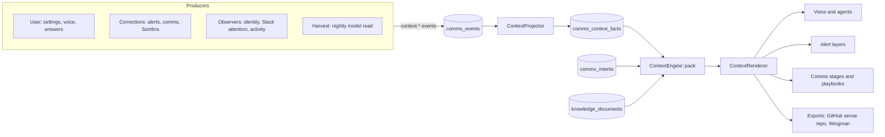

# Context plan

How sixth-sense keeps what it knows about the user's work in one place, learns it in one way, and gives it to every model in one way.

Today the same facts are produced by five mechanisms, stored in nine tables, and read by about fifteen classes that each build their own prompt block. Some layers know a fact that others never see. This plan replaces that with one store, one write path and one read path. It follows the rules of [architecture.md](architecture.md) and [implementation-plan.md](implementation-plan.md): state in code, judgment in models, the log as the source of truth, replayable projections.

---

## 1. What exists today

### 1.1 Stores

| Store | Table | What it holds | Written by | Comms pipeline reads it |
|---|---|---|---|---|
| Nightly context | `work_contexts` | One JSON digest: summary, workstreams, people, contacts (with language), open loops, writing style per channel, hot files and pages, recent Jira | `BuildWorkContext` at 04:30, a model summarizing five sources | No |
| Lessons | `intent_lessons` | Short sentences learned from corrections, per layer (`judge`, `triage`, `classifier`, `reply`, `scheduler`, or all) | `ProposalOutcomes`, `LearnFromOutcome` + `LlmLessonWriter`, `AlertActions`, the Lecciones page | No |
| Slack attention | `slack_attention_profiles`, `slack_preference_rules`, `slack_autonomy_levels` | Who and which channels the user answers, rules the user said, autonomy per kind | `SlackAttention` heuristics every Monday at 06:00, voice corrections, Avisos page | No |
| Slack familiar | Redis `slack-activity:*` | With whom and where the user talks most | `chats:warm` every hour | No |
| Knowledge corpus | `knowledge_documents` | Copies of the work archive, Jira, Notion, meetings, answered questions | `knowledge:sync` every 15 min, full at 03:30 | No |
| Knowledge gaps | `knowledge_gaps` | Questions the system asked about terms and meetings, and the answers | `knowledge:ask` every hour at :20, the user's answers | No |
| Jira rules | `connected_accounts.rules` | What the user told the assistant about a Jira site | Jira rules page | No |
| Archive (comms) | `comms_people`, `comms_identities`, `comms_owned_areas`, `comms_preferences` | People, relation, importance, identities, owned areas, working hours | `IdentityResolver`, `Archive` via `user.configured` from the Personas page | Yes |
| Corpus (comms) | `comms_documents` | Documents for `ContextEngine::search` | **Nothing in `app/` writes it.** Only tests do. | Yes, empty |
| Open intents (comms) | `comms_intents` | What is open, who waits on whom | The comms state machine | Yes |
| Comms corrections | `comms_events` `user.corrected`, `user.answered` (`feedback`) | Re-match, close, importance; Sombra feedback | Intent corrections, Sombra | Yes, for the intent only. Nothing is learned from them. |

### 1.2 Readers

Each reader picks its own stores and writes its own header:

| Reader | Reads | Header in the prompt |
|---|---|---|
| `AssistantProfile` (voice, and every agent through `AgentRunner`) | Nightly digest, Slack familiar, answered gaps, knowledge search directive, sense archive, Jira rules, open comms item | `Contexto de su trabajo estos días…`, `Con quién y dónde habla más en Slack…`, `Lo que el usuario te ha explicado cuando preguntaste:` |
| `IntentAssigner` → `LlmIntentClassifier` | Digest summary, Slack attention profile, `triage` lessons | `--- Contexto (datos) ---`, `Política de atención en Slack…`, `Aprendido al resolver avisos anteriores:` |
| `LlmRelevanceJudge` | `judge` lessons | `Aprendido de avisos anteriores (datos):` |
| `LlmActionClassifier` | `classifier` lessons | same |
| `LlmReplyPlanner`, `IntentResearch`, `SlackDraft` | Digest summary, `reply` lessons, knowledge search | `Contexto de trabajo:`, `Ya aprendido:`, `Lo que dicen el archivo de trabajo…` |
| `LlmTaskAssessor`, `Scheduler` | Digest summary, `scheduler` lessons | own |
| `AgentRunner` (agent `comunicacion`) | `reply` lessons | `Lessons::render` |
| `PublishContext` | Digest, answered gaps | Markdown files in the GitHub sense repo |
| Comms `TriageRules`, `ImportanceCalculator`, `MatchStage`, playbooks | Archive, open intents, `comms_documents` | none (JSON input) |

### 1.3 What goes wrong because of it

1. **The same fact has several owners.** A person's relation is in `comms_people` (the user set it) and in the digest (a model guessed it). Their importance in Slack is in the attention profile. Their language is only in the digest. Nobody decides which one wins, and each reader sees a different one.
2. **What the user teaches is lost on the other side.** A correction in the alerts becomes a lesson that the comms pipeline never reads. Sombra feedback and intent corrections become events that teach nothing.
3. **Open loops are written twice.** The digest has a model-written list. The comms pipeline has intents with state. They disagree.
4. **The comms pipeline reads an empty corpus.** `comms_documents` has no writer. `knowledge_documents` has the corpus.
5. **Nothing knows why a model said something.** A prompt block is a rendered string with no references, so a wrong answer cannot be traced to the fact that caused it, and a fact cannot be retired when it is wrong.
6. **Each new consumer adds a new header.** There are seven headers for "what you know". Each layer caps, orders and ages its facts differently.

---

## 2. The target



Three rules:

1. **One store of facts.** Everything the system believes about the user's world is a row in `comms_context_facts`: a person's relation, their language, an owned area, working hours, how the user writes in Slack, what they are working on, a rule learned from a correction, the answer to a question it asked. Open loops are not facts. They are `comms_intents`. Documents are not facts. They are the corpus.
2. **One way to learn.** Every producer appends an event. One projector applies it with one precedence rule. No producer writes a fact table directly.
3. **One way to read.** Every consumer asks `ContextEngine::pack()` for an audience and its subjects, and renders the result with `ContextRenderer`. No consumer queries a fact table or builds its own header.

---

## 3. The fact

### 3.1 Shape

`comms_context_facts` (projection, rebuilt by replay):

| Column | Type | Role |
|---|---|---|
| `id` | bigint pk | |
| `user_id` | fk | Owner |
| `kind` | string(24) | See 3.2 |
| `subject` | string(191) | What it is about: `person:{ref}`, `area:{kind}:{ref}`, `channel:{source}:{ref}`, `user`, `term:{slug}`, `workstream:{slug}` |
| `attribute` | string(48) | `relation`, `importance`, `language`, `role`, `team`, `tone`, `hours`, `owns`, `rule`, `meaning`, `summary`, … |
| `value` | json | The value. A sentence for `rule`, `meaning` and `summary`. |
| `audiences` | json | Who may read it (3.4). Empty means every audience. |
| `origin` | string(16) | `user`, `correction`, `observed`, `inferred` |
| `confidence` | decimal(3,2) | 1.00 for `user`. As produced otherwise. |
| `refs` | json | Where it came from: `evt:…`, `gap:…`, `slack:…`, `outcome:…` |
| `status` | string(16) | `active`, `proposed`, `superseded`, `rejected`, `expired` |
| `sensitive` | bool | Never rendered for voice or exports |
| `event_id` | fk | The event that produced this version |
| `confirmed_at` | timestamp | Last time a producer or the user confirmed it |
| `last_used_at` | timestamp nullable | Last time a pack included it |
| `uses` | int | |

Unique active fact per `(user_id, subject, attribute)` for single-valued attributes (`relation`, `language`, `hours`, `tone`). Multi-valued attributes (`rule`, `owns`) are unique on `(user_id, subject, attribute, sha1(value))`.

`comms_context_uses` (outside the log, like AI usage): `fact_id`, `audience`, `model_call_ref` (the `model.decided` key or the AI usage id), `created_at`. This is what makes "why did it say that" answerable.

### 3.2 Kinds

| Kind | Examples | Replaces |
|---|---|---|
| `person` | relation, importance, role, team, language, how to address them | `comms_people` columns, digest `people` and `contacts`, attention weights |
| `area` | owns, keywords | `comms_owned_areas` |
| `preference` | working hours, time zone, locale, tone per channel | `comms_preferences`, digest `writing` |
| `channel` | answers here, ignores here | attention profile signals, Slack preference rules |
| `workstream` | what, why, with whom, where, next step | digest `workstreams`, `hot_files`, `hot_pages`, `jira` |
| `rule` | "A message from Iván like X does not ask for a call" | `intent_lessons`, Slack preference rules, Jira rules |
| `term` | what a word or a meeting means here | answered `knowledge_gaps` |
| `summary` | the one-paragraph "what the user is doing these days" | digest `summary` |

`comms_people` and `comms_identities` stay as tables because identity resolution and message authors need a row to point at. Their judgment columns (`relation`, `importance_weight`, `team`, `role`) become projections of the active facts for that person, kept for the joins the pipeline already does.

### 3.3 Precedence

When two producers disagree on a single-valued fact:

1. `user` beats everything. A user fact is replaced only by another user fact.
2. `correction` beats `observed` and `inferred`.
3. `observed` (counted by code) beats `inferred` (guessed by a model).
4. Between equals, the newest wins and the older one becomes `superseded`.

A lower-origin value that contradicts a higher one is stored as `proposed`, never applied. When a `proposed` fact has been produced at least 3 times over at least 7 days, it raises one question ("¿Marta sigue siendo tu responsable?"). This reuses the knowledge-gap question limits: at most 3 questions per day, 9:00 to 19:00. The answer is a `user` fact.

A fact the user deletes becomes `rejected`. A producer that emits the same value again does not bring it back.

### 3.4 Audiences

Every reader is one audience. A fact is readable by an audience if its `audiences` list is empty or contains it.

| Audience | Who | Kinds it reads | Budget |
|---|---|---|---|
| `voice` | `AssistantProfile`, agents | all except `rule` for other layers | 1,500 tokens |
| `importance` | `LlmRelevanceJudge`, comms `ImportanceCalculator` | person, area, channel, rule | 400 |
| `triage` | `IntentAssigner`, comms triage | person, channel, area, rule | 400 |
| `classifier` | `LlmActionClassifier` | person, rule | 300 |
| `match` | comms `MatchStage` | person, preference, rule | 300 |
| `reply` | `LlmReplyPlanner`, `IntentResearch`, `SlackDraft`, agent `comunicacion`, comms `answer` and drafts | person (subject first), preference (tone), workstream, term, rule | 800 |
| `scheduler` | `LlmTaskAssessor`, comms `prepare_work` | preference, workstream, rule | 400 |
| `export` | `PublishContext`, Wingman | all non-sensitive | none |

The lesson layers map one to one: `judge` → `importance`, `triage` → `triage`, `classifier` → `classifier`, `reply` → `reply`, `scheduler` → `scheduler`, and no layer → empty audiences.

---

## 4. Generation

Every producer appends one of these events. All of them go through `EventLog::append()`, and the existing consumer applies them in order with the per-user lock.

| Event | Origin | Producer |
|---|---|---|
| `user.configured` (exists) | `user` | Settings pages, voice ("Marta es clienta"), answers to context questions |
| `context.corrected` | `correction` | `ProposalOutcomes`, `AlertActions`, `LearnFromOutcome`, comms `user.corrected`, Sombra feedback |
| `context.observed` | `observed` | `IdentityResolver`, `SlackAttention`, Slack familiar (from the warm cache, once a day), contact language counted from sent messages |
| `context.inferred` | `inferred` | `ContextHarvest` (today's `BuildWorkContext`), `LlmLessonWriter` |

Each event's `normalized` is a list of fact operations: `{op: set|add|remove|reject, kind, subject, attribute, value, audiences, confidence, refs}`. The projector validates the shape, applies precedence, and writes `state.applied` with what was accepted and what stayed `proposed`, as the state machine already does for intents.

**Model output is an input.** `context.inferred` stores the harvested facts in the event itself. Replay applies them without calling the model, the same way it treats source events. The harvest prompt is versioned like every comms prompt.

**Corrections teach once.** `context.corrected` replaces the two paths that exist today (lessons for alerts, nothing for comms). A Sombra "not urgent" on a notification about Marta produces `rule` for `importance` with subject `person:marta`. An intent re-matched by the user produces a `rule` for `match`. The rule sentence is written by `LlmLessonWriter`, which moves to `App\Comms\Context\RuleWriter` and serves both pipelines.

**The nightly read becomes a harvest.** `ContextHarvest` reads the same five sources as `WorkActivityCollector`, but it returns facts, not a digest. Each fact carries the refs it came from. It does not write open loops, because those are intents. A harvest that returns nothing for a fact it returned last time does not delete it. The fact expires when its `confirmed_at` is older than 14 days.

**Retirement.** A `rule` not used for 60 days, or an `inferred` fact not confirmed for 14 days, becomes `expired` on the daily `clock.digest` tick. `user` facts never expire.

---

## 5. Consumption

### 5.1 One call

```php
$pack = $context->pack($user, new ContextRequest(
    audience: Audience::Reply,
    subjects: ['person:marta', 'area:jira_project:PAY'],
    intent: $intent,      // optional: adds the conversation and linked intents
    query: $text,         // optional: adds corpus search results
));
```

`ContextPack` holds typed items, each with its ref: facts (ordered: subject first, then origin, then recency), open intents involving the subjects, corpus results from `knowledge_documents`, and findings from `Precedence`. The engine trims to the audience budget, marks `last_used_at` and `uses`, and returns the fact ids so the caller records them in `comms_context_uses` with its model call.

### 5.2 One rendering

`ContextRenderer::forModel($pack)` produces one block with one header, the item refs and the data wrapper from section 3.8 of the implementation plan:

```
<context role="data">
Personas:
- [person:marta] Marta Ruiz · responsable · escribe en español (lo dijiste tú)
Reglas aprendidas:
- [fact:812] Un mensaje de Iván como «¿hablamos?» no pide una llamada.
Abierto:
- [intent:41] Marta espera el flujo de prepago antes del jueves.
</context>
```

`ContextRenderer::forVoice($pack)` produces the same content as prose for the voice session, without refs and without sensitive facts. `ContextRenderer::forExport($pack)` produces the Markdown files `PublishContext` writes today.

Every model that receives a pack may cite `[fact:…]` refs. `verify_claims` treats them as refs.

### 5.3 What each reader becomes

| Reader | Today | After |
|---|---|---|
| `AssistantProfile` | 5 own blocks | `pack(voice)` + the sense archive and tool rules, which are instructions, not facts |
| `IntentAssigner` | digest summary + attention profile + `triage` lessons | `pack(triage, subjects: [sender, channel])` |
| `LlmRelevanceJudge` | `judge` lessons | `pack(importance, subjects: [sender])` |
| `LlmActionClassifier` | `classifier` lessons | `pack(classifier, subjects: [sender])` |
| `LlmReplyPlanner`, `IntentResearch`, `SlackDraft` | digest summary + `reply` lessons + knowledge search | `pack(reply, subjects: [recipient], query: message)` |
| `LlmTaskAssessor`, `Scheduler` | digest summary + `scheduler` lessons | `pack(scheduler)` |
| `AgentRunner` | profile + `reply` lessons | `pack(voice)`; `pack(reply)` for `comunicacion` |
| Comms triage, match, importance | archive rows | `pack(triage|match|importance)`; the projected `comms_people` columns stay for code that only needs a weight |
| Comms playbooks | `ContextEngine::archive()`, `search()` over `comms_documents` | `pack(reply|scheduler, intent:, query:)`, searching `knowledge_documents` |
| `PublishContext` | digest + gaps | `pack(export)` rendered as files |
| Wingman `MeetingContext` | own reads | `pack(reply, subjects: attendees)` plus its meeting reads |

An architecture test enforces it: outside `App\Comms\Context`, nothing reads `comms_context_facts`, `work_contexts`, `intent_lessons`, `slack_attention_profiles`, or answered `knowledge_gaps`.

---

## 6. Surface

Settings has one **Contexto** section in place of Personas, Contexto and Lecciones:

| Tab | Shows | Edits produce |
|---|---|---|
| Personas | People with relation, importance, language, role; where each value came from (tú / aprendido / visto / deducido) and its refs | `user.configured` |
| Áreas y horario | Owned areas, working hours, tone per channel | `user.configured` |
| Lo que sé | Summary, workstreams, terms; each with refs and age; the nightly read switch and its last run | Delete → `reject`; edit → `user` fact |
| Reglas | Learned rules by audience, with uses and last use; the inertia review that Lecciones shows today | Edit → `user` fact; delete → `reject` |
| Pendiente de confirmar | `proposed` facts that contradict something | Accept or reject |

Sombra is not context. It is the comms notifier in shadow mode, and it stays as it is until a source is switched on. Its feedback buttons feed `context.corrected` from phase C3.

The voice can read and change the same facts with two tools: `what_do_you_know(subject)` and `remember(subject, attribute, value)`. They use the same engine and the same events.

---

## 7. Phases

Each phase is one merge, tested, and leaves the app working. Old paths stay until the phase that removes them. Flags in `config/context.php`.

### Phase C0 — Inventory and guard

- Architecture test listing every class that reads a context table today, as an allow-list. A new reader fails the test.
- Golden fixtures: for one user state, the prompt block each reader produces today, stored as text. Later phases compare against them.
- Decide where `comms_documents` goes: `ContextEngine::search()` reads `knowledge_documents`. `comms_documents` is dropped in C5. `Precedence` reads `topic` from a column added to `knowledge_documents`.

**Done when** the allow-list test and the fixtures pass, and comms search returns documents from the real corpus.

### Phase C1 — Store, events, projector

- Migration for `comms_context_facts` and `comms_context_uses`.
- Event types `context.corrected`, `context.observed`, `context.inferred`. `user.configured` gains `kind: fact`.
- `ContextProjector` with precedence, `proposed`, `rejected`, expiry on `clock.digest`.
- `comms_people` judgment columns projected from facts. `Archive::apply()` writes facts.
- `comms:context-import {user}`: one event per existing store, in this order so precedence matches reality: `context.inferred` from `work_contexts.digest`; `context.observed` from `slack_attention_profiles`; `context.corrected` from `intent_lessons` (layer → audience) and accepted `slack_preference_rules`; `user.configured` from answered `knowledge_gaps`, `connected_accounts.rules` and the current `comms_people` relations set by the user.
- Replay rebuilds `comms_context_facts`.

**Done when** importing a seeded user and replaying gives the same facts, a user fact survives an inferred contradiction as `proposed`, and a rejected fact is not brought back.

### Phase C2 — One read path, in shadow

- `ContextEngine::pack()`, `ContextRequest`, `ContextPack`, `Audience`, `ContextRenderer`.
- For each reader in 5.3, behind `context.reads.{audience}` (default `legacy`): in `shadow`, build both blocks, send the legacy one, and log the diff and token counts to `storage/context/diffs/`. In `unified`, send the pack.
- `comms_context_uses` recorded on every model call that received a pack.

**Done when** every reader has a `shadow` mode, the golden fixtures from C0 render with no lost facts, and the token count per audience stays inside its budget.

### Phase C3 — One write path

- Producers switch to events: `ProposalOutcomes`, `AlertActions`, `LearnFromOutcome`, `SlackAttention`, `SlackPreference`, `GapQuestions::answer`, the Jira rules page, the Personas page, comms corrections, Sombra feedback.
- `BuildWorkContext` becomes `ContextHarvest` and emits `context.inferred`. Its schedule stays at 04:30. It writes no open loops.
- `LlmLessonWriter` becomes `RuleWriter` in `App\Comms\Context`.
- Old tables are still written by a compatibility listener on the projector, so readers still on `legacy` keep working.

**Done when** every producer appends events only, a Sombra "no era urgente" changes the next `importance` pack for that sender, and an alert correction changes the next comms `match` pack.

### Phase C4 — Switch reads, one audience at a time

Order, from least to most visible: `scheduler`, `classifier`, `importance`, `triage`, `match`, `reply`, `export`, `voice`. Each one moves from `shadow` to `unified` after a week of diffs the user has read with nothing lost. The settings section from section 6 ships with this phase.

**Done when** every audience is `unified` and the allow-list from C0 contains only `App\Comms\Context`.

### Phase C5 — Remove

Needs explicit approval, because it drops data:

- Drop the compatibility listener.
- Drop `work_contexts.digest`, `intent_lessons`, `slack_attention_profiles`, `slack_preference_rules.body`, `comms_documents`, and the old settings pages.
- Remove `WorkDigest::forAssistant`, `Lessons::render`, `IntentAssigner::context`.

**Done when** the full suite passes, and replaying the event log alone rebuilds everything the readers need.

---

## 8. Defaults

| Setting | Value |
|---|---|
| Inferred fact expiry without reconfirmation | 14 days |
| Rule expiry without use | 60 days |
| Proposed fact raises a question after | 3 productions over ≥ 7 days |
| Context questions | ≤ 3 per day, 9:00–19:00, shared with knowledge gaps |
| Facts per subject in a pack | 6 |
| Rules per pack | 8 (today's `Lessons::LIMIT`) |
| Budgets | Section 3.4 |
| Harvest | 04:30, one model call per source, schema-checked |

---

## 9. Risks

- **A unified block is longer than a legacy one.** Budgets are per audience, and C2 measures tokens before anything switches.
- **A wrong inferred fact reaches every layer at once,** where today it reached only the voice. Inferred facts never override user or observed ones, they expire in 14 days, and every pack is traceable to the fact ids it used.
- **Replay cost grows with harvest events.** A harvest is one event per run with all its facts, not one event per fact.
- **MySQL in production.** `knowledge_documents` full-text uses Postgres language settings locally. The search query in C0 must be tested on MySQL `FULLTEXT` before C2.
- **The comms switches are still off.** Nothing here depends on them. Facts are shared by both pipelines from C3, so the cutover inherits what the alerts already learned.

---

## 10. Open decisions

1. Whether `rule` facts written by a model (`RuleWriter`) count as `correction` or as `inferred`. This plan says `correction`, because a person caused them.
2. Whether the voice can set a fact without confirmation. This plan says yes, because it only changes what sixth-sense knows, not anything outside it, so the "sí" rule does not apply.
3. Whether Slack familiar stays in Redis as a cache feeding `context.observed` once a day, or is computed from `comms_messages`. This plan keeps the cache until Slack ingestion covers enough channels.
4. Whether Wingman meeting context moves in C4 or stays separate. It is built per meeting, so it can wait.
