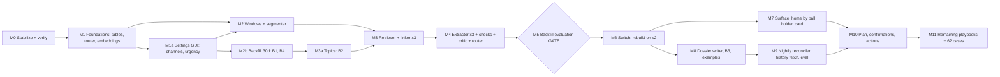

# Execution plan — comms pipeline, 0 to 1

Status: draft for the user's review, 2026-11-15.
Audience: the user and the coding agent.

This plan turns the decided design into an ordered set of deliveries. It covers dependencies,
infrastructure, data structure, backend, frontend, tests and the merge gate of every delivery.

Sources, in order of authority:

1. [linking-intents-and-surface-proposal.md](linking-intents-and-surface-proposal.md) section 1 (D1–D10). Wins over everything.
2. [agent-definitions.md](agent-definitions.md): one definition per agent and code stage.
3. [comms-processing.md](comms-processing.md): vocabulary and principles.
4. [architecture.md](architecture.md), [implementation-plan.md](implementation-plan.md): components, tables, config, golden sequences (already edited to match D1–D10).
5. [context-plan.md](context-plan.md): where topics, ask patterns and learned rules are stored.
6. [intents-use-cases.md](intents-use-cases.md): the 62 cases.

Do not build from [superseded-2026-11-15.md](superseded-2026-11-15.md).

---

## 0. The starting point

This is not a greenfield build. `app/Comms` (about 12 000 lines) already implements phases 0 to
7.1 of the implementation plan **on the pre-2026-11-15 design**, and runs in production with
`COMMS_PIPELINE_SLACK=true` and `COMMS_PIPELINE_GMAIL=true`
([errores-prod-2026-11-11.md](errores-prod-2026-11-11.md)).

So "0 to 1" here means: keep the foundations that already match, replace the middle of the
pipeline (message → intent), add the backfill, the nightly loop and the new surface, and get
there without losing the current production behaviour on the way.

### 0.1 Inventory against the decided design

| Area | Today in the code | Decided design | Action |
|---|---|---|---|
| Event log, `EventLog::append`, dedupe, replay | `comms_events`, `Replay`, `comms:replay` | Same | **Keep** |
| Per-user serialized consumer | `ProcessCommsEvent` with in-order check | Same | **Keep** |
| Ingestion Slack/Gmail, read-only clients, identities | `Ingestion/*`, `ReadOnlySlackClient`, `IdentityResolver` | Same, plus `scope.slack.extra_channels` (D9) | **Extend** |
| Triage | `TriageRules` + model `triage` | Rules drop automated only; model flags only, never drops (D1) | **Change** |
| Matching | `MatchStage`, 1 run per message, last 5 thread messages, mid tier, confidence escalation | Window → segment → retrieve → link ×3 → match v2 ×3 → checks → critic → router (D2, D4, D5, D7) | **Replace** |
| Candidate retrieval | `CandidateRetriever` over intents only | Hard links → topics (keyword + embedding) → intents | **Replace** |
| State machine | `IntentStateMachine` (767 lines) | Same rules, plus `uncertain` intents and link states, `kind`, `steps`, unclear fields | **Extend** |
| Topics | `workstream` facts exist via `ContextHarvest` (nightly digest) | Topics are `workstream` + `term` facts, built by backfill B2 and kept by the dossier writer (D5) | **Extend** |
| Context store | `comms_context_facts`, `ContextEngine::pack`, projector, precedence | Same. Ask patterns as `rule`/`person` facts `origin=observed` | **Keep** |
| Model router | `ModelRouter::ask`, DeepSeek/Gemini via `app/Ai`, one provider for every task, decision keys without `run_index` | Tasks `segment`, `link`, `match` v2, `critic`, `dossier_write`, `reconcile`; provider per task (section 1.1); key includes `run_index` | **Extend** |
| Embeddings | None. The `embed` task asks a model for a one-sentence summary, and similarity is `similar_text` on strings (`IntentStateMachine`, `ContextEngine`) | Real vectors from the Gemini embeddings API, cached in `comms_embeddings`; used by the retriever, the duplicate check and the agreement check on `what` | **New** |
| Database | Local and tests on Postgres (`phpunit.xml`); production on Forge is **MySQL**. `KnowledgeBase` already branches per driver | Everything must run on MySQL. No Postgres-only feature | **Constraint** |
| Backfill | `comms:backfill` (14 days, ingest only) | 30 days + passes B1–B5 + built-in evaluation (D6) | **Extend** |
| Nightly reconciler, history fetch, weekly eval | None | N1–N3 (D8) | **New** |
| Golden set | Fixtures in `tests/Fixtures/Comms` (2 files) and phase tests | Fixed sequences + B4 weak labels + corrections, replayed weekly | **New** |
| Watchers, clock, notifier | `Watchers/*`, `Notifier`, `comms:tick` | Same | **Keep** |
| Gate, write tools, `PendingAction` | `Gate`, `HardDenies`, 10 write tools | Same, plus: proposal on an uncertain link is always asked | **Extend** |
| Playbooks | 6 playbooks + 5 steps | Same, plus: no playbook on an uncertain intent | **Extend** |
| Home surface | `HomeFeed`, `intent-board.tsx`, "Para mí" alert cards | Home by ball holder, intent card, plan checklist, 3 confirmation kinds (D10) | **Replace** (UI) |

### 0.2 Production debts that block the new design

From [errores-prod-2026-11-11.md](errores-prod-2026-11-11.md). Several were addressed by later
commits (`744d17a`, `c4a9037`, `5e23670`, `d43a804`, `4c1771e`, `e18bf86`). **M0 verifies each
one against production data before anything else is built**, because the new pipeline inherits
ingestion, the gate and the write tools as they are.

| Id | Problem | Why it blocks |
|---|---|---|
| E-03 | Calendar/Notion write tools were stubs; email had `account_id = 0`; `ProposalEcho` re-ingested internal actions | Plans (7.5) and approvals (7.6) depend on real writes and a clean echo |
| E-04 | Literal quote check rejected 24 % of operations | The quote check stays a hard rule; it must be whitespace and quote-prefix tolerant |
| E-05 | User's own Slack thread replies not ingested | Settling, B4 labels and ask patterns all need the user's outgoing messages |
| E-06 | Everyone `unknown`, DM bursts fragmented into 8 intents | Fragmentation is exactly what windows and segments fix; weights need B1 + archive |
| E-07 | Jira notification emails duplicated the Jira connector | D1 says never drop human mail; automated notification mail is not human and stays droppable by rule |

---

## 1. Decisions

Taken by the user on 2026-11-15, on top of the proposal's section 1:

| # | Decision | Consequence in this plan |
|---|---|---|
| Q1 | **Only DeepSeek and Gemini.** No Anthropic. | Model allocation in 1.1. No new driver for text; one new HTTP call for Gemini embeddings. |
| Q2 | **MySQL in production (Forge).** `pg_trgm` and every Postgres-only feature are out. | Search uses Laravel `fullText` indexes and `whereFullText`, which work on both drivers. Nicknames use an alias table. Tests also run on MySQL (section 8). |
| Q3 | **The user configures scope and urgency in the GUI.** | Slack extra channels and urgent rules are per-user settings with their own screens (section 7a). Nothing is hard-coded in config beyond defaults. |
| Q4 | Per-window token budget | Measured in M5. Until then `budget.per_window_tokens = 150 000`, logged, not enforced. |
| Q5 | The old matcher does not run alongside v2 | One brain. The switch is a rebuild from the log (section 9). |

### 1.1 Model allocation

Chosen from what `config/ai.php` already configures. Names are env values, so a newer model is
a `.env` change.

| Task | Runs | Provider · model | Fallback | Why |
|---|---|---|---|---|
| `triage` (flags), `route`, `watcher_check` | 1 | DeepSeek · `DEEPSEEK_LIGHT_MODEL` (flash) | Gemini · flash-lite | High volume, low stakes. Confidence escalation stays for these three only. |
| `segment` | 1 | DeepSeek · `DEEPSEEK_MODEL` (v4-pro) | Gemini · flash | Every later step reads `restated`; a weak segment ruins the window. |
| `link` | 3 | DeepSeek · v4-pro | Gemini · flash (an invalid run counts as disagreeing; fallback only on transport failure) | Strongest model available, as the user chose slow and correct. |
| `match` v2 | 3 | DeepSeek · v4-pro | Gemini · flash (same rule) | Same. |
| `critic` | 1 | **Gemini** · `ALERTS_GEMINI_MODEL` (flash) | DeepSeek · v4-pro | A different model family from the extractor, so the critic does not share the extractor's blind spots (architecture 5.2: "different model or different prompt"). A refutation still needs a valid quote, so a weaker critic cannot invent one. M5 measures it against DeepSeek as critic; swap if DeepSeek refutes better. |
| `dossier_write`, `ask_pattern`, `identity_resolve` | 1 | DeepSeek · v4-pro | Gemini · flash | Structured output, low volume. |
| `topic_build`, `reconcile` | 1 | DeepSeek · v4-pro | Gemini · flash | Long inputs, once per backfill or per night. |
| Drafts and playbook tasks (`draft`, `answer`, `verify_claims`, …) | 1 | As today | As today | Not changed by this plan. `verify_claims` moves to Gemini for the same reason as the critic. |
| Embeddings | — | **Gemini** embeddings API · `GEMINI_EMBED_MODEL` | none; on failure, string similarity as today | DeepSeek offers no embeddings endpoint. |

Two rules that keep the cost of 3 runs down:

- **Prompt order for caching.** DeepSeek caches identical prompt prefixes and bills cache hits
  at a fraction of the price. Every `link` and `match` prompt is ordered: system text, then the
  segment, ask patterns and examples (identical in the 3 runs), then the candidates (shuffled per
  run) last. Runs 2 and 3 then pay full price only for the candidate block.
- **Where the variation comes from.** The 3 runs differ by candidate order (shuffled with the
  run index as seed, so replay is deterministic) and by the provider's default temperature. They
  are never 3 copies of the same request.

`config/comms.php` gains a `provider` per task (today one global provider and one fallback
apply to every task).

---

## 2. Dependencies

### 2.1 Packages

No new PHP or JS package and no database extension is required. Everything below uses what is
installed: Laravel 13, Inertia 3, React 19, Tailwind 4, Horizon, Reverb, Pest 4, MySQL in
production.

| Need | How, with what is installed | Works on MySQL |
|---|---|---|
| Keyword search over dossiers and terms | Schema `fullText()` index + `whereFullText()`, branching per driver the way `KnowledgeBase::search` already does (natural-language mode on MySQL, `websearch` on Postgres) | Yes |
| Names and nicknames | `comms_topic_aliases`: each nickname stored normalized (lowercase, accents and punctuation removed). Exact and prefix match in SQL, then PHP `levenshtein` over the user's alias list (hundreds of rows), then embeddings | Yes |
| Embeddings | `ModelRouter::embed()` calls the Gemini embeddings endpoint over Laravel's HTTP client (no SDK); cached in `comms_embeddings` | Yes (vectors as JSON) |
| Vector search | Not in v1 (implementation plan decision 9). Cosine in PHP over capped candidate lists. Revisit only if retriever p95 > 1.5 s | Yes |
| Reranker | The `link` agent already selects among ≤ 10 candidates; rank-merge (reciprocal rank fusion) in code. No reranker model | Yes |
| JSON columns | Plain `json`. No `jsonb` operators, no Postgres array types, no partial indexes. Uniqueness that needs a condition (one open window per group) uses a generated column or an application lock | Yes |

MySQL full-text details to handle in code: `innodb_ft_min_token_size` is 3 by default, so
two-letter terms ("QA", "PR") are not indexed and must go through the alias table; MySQL has a
built-in English stopword list and no Spanish one; there is no stemming. The alias table and the
embeddings cover what full text misses.

### 2.2 Delivery dependency graph



Critical path: M0 → M1 → M2 → M3 → M4 → **M5 gate** → M6 → M7 → M10 → M11.

---

## 3. Infrastructure

| Item | Change |
|---|---|
| MySQL (production) | Migrations in section 4, written driver-neutral. `fullText` index on `comms_topic_search.document`. Before M3: confirm on Forge that the MySQL version is 8.0 or later and read `innodb_ft_min_token_size`. |
| Postgres (local, tests) | Stays for now. A second test run on MySQL is added in M1 (section 8). Moving local development to MySQL too would remove the mismatch; it is the user's call. |
| Redis | Settle-buffer timers do not live in Redis: the buffer is a projection (`comms_windows`) checked by `comms:tick`. Redis stays for locks and queues. |
| Horizon queues | Add `comms-windows` (segment → route for one window; one at a time per user, it reads state) and `comms-nightly` (reconciler, history fetch, eval; low priority, long timeout 900 s). Keep `comms-ingest`, `comms-decide`, `comms-playbooks`, `comms-writes`. Model runs of one window (3 link, 3 match) are dispatched in parallel as a `Bus::batch` and joined before the router; they read state but do not write it. |
| Scheduler (`routes/console.php`) | `comms:tick` (exists) also settles windows. New: `comms:reconcile-nightly` at `reconcile.time` in the user's zone; `comms:eval --weekly` Mondays 05:00; `comms:labels` nightly (B4 on new data); `comms:ask-patterns` monthly. Note: `comms:reconcile` already exists and is the 10-minute **poll** reconciliation; the nightly command needs a different name. |
| Reverb | New broadcast events on the user's private channel: `IntentCardChanged` (card moved or updated), `HomeCountsChanged`. Fixes E-05's "home does not refresh". |
| Config | `config/comms.php` additions in section 6. Feature flags: `comms.linking.v2` (off), `comms.surface.v2` (off), `comms.reconciler.enabled` (off). |
| Storage | `storage/comms/evals/{date}.json` and `storage/comms/backfill/{run}.json` for reports. |
| Observability | Every model call already logs to AI usage tables. Add `window_id` and `run_index` columns so cost per window is a query. |
| Cost | Measured in M5 (B5 over 30 days gives cost per window × windows per day). Written into this document before M6. |

---

## 4. Data structure

All new tables follow implementation plan 4.2: `id`, `user_id`, timestamps, `comms_` prefix,
rebuilt by replay unless marked "cache" or "outside the log".

### 4.1 New tables

**`comms_windows`** — projection of the settle buffer.

| Column | Type | Notes |
|---|---|---|
| `source` | string(16) | |
| `group_ref` | string(255) | channel or thread ref |
| `kind` | enum `channel`, `dm`, `thread` | picks the quiet time |
| `message_ids` | json | new messages in this window |
| `opened_at`, `last_message_at` | timestamp | |
| `settled_event_id` | fk nullable | the `window.settled` event |
| `state` | enum `open`, `settled`, `processed` | |

Unique open window per `(user_id, source, group_ref)`.

**`comms_segments`** — projection of `segment` decisions, so links and the reconciler can point at a segment.

| Column | Type |
|---|---|
| `window_id` | fk |
| `message_ids`, `new_message_ids` | json |
| `participants` | json (person ids) |
| `restated` | text |
| `unresolved_refs` | json |
| `unsegmented` | bool |
| `decision_event_id` | fk |

**`comms_link_decisions`** — the code decision after the linker runs, one per segment.

| Column | Type |
|---|---|
| `segment_id` | fk |
| `topic_subject` | string(191) nullable (`workstream:{slug}`) |
| `intent_id` | fk nullable |
| `outcome` | enum `topic_intent`, `topic_new_intent`, `new_topic`, `none` |
| `certainty` | enum `certain`, `uncertain` |
| `agreement` | enum `3of3`, `2of3`, `none` |
| `alternative` | json nullable (`{topic_subject?, intent_id?}`) |
| `quote` | text |
| `run_event_ids` | json |
| `event_id` | fk (`link.decided`) |

**`comms_embeddings`** — cache, outside the log. `hash` sha1, `model`, `vector` json, `created_at`. Unique `(hash, model)`.

**`comms_topic_search`** — search projection over topics. `topic_subject`, `document` text (summary + terms + people names) with a `fullText` index, `embedding_hash`. Rebuilt from `workstream` and `term` facts by the context projector.

**`comms_topic_aliases`** — projection of `term` facts. `topic_subject`, `alias` (as written), `alias_normalized` string(191) indexed. Unique `(user_id, alias_normalized, topic_subject)`.

**`comms_urgent_rules`** — per-user, edited in the GUI (section 7a), written through `user.configured`.

| Column | Type |
|---|---|
| `kind` | enum `person`, `keyword`, `channel` |
| `ref` | string (person id, keyword, or `slack:{channel_id}`) |
| `sources` | json (which sources the rule applies to; empty = all) |
| `active` | bool |

Read by the settle buffer (skip the wait) and by triage (urgent flag). Seeded with one default
the user can delete: DMs from people with weight ≥ 35.

**`comms_golden_labels`** — golden set, outside replay of projections but written through events.

| Column | Type |
|---|---|
| `kind` | enum `weak_label`, `correction`, `fixture` |
| `message_id` / `segment_id` | fk nullable |
| `label` | string (`acted`, `ignored`, `relink`, `not_for_me`, `merge`, `split`, …) |
| `expected` | json |
| `evidence_event_ids` | json |
| `people`, `topics` | json (for example retrieval) |
| `source_event_id` | fk |

**`comms_reconcile_changes`** — the morning change list.

| Column | Type |
|---|---|
| `run_date` | date |
| `op` | enum `merge`, `split`, `settle`, `confirm_link`, `relink`, `merge_topics` |
| `payload` | json |
| `quote`, `why` | text |
| `disposition` | enum `applied`, `proposed`, `accepted`, `rejected`, `undone` |
| `decision_event_id`, `applied_event_id` | fk |

**`comms_card_views`** — when the user last opened each card. `intent_id`, `seen_at`. Drives "changed since you last looked". Written through `user.viewed` events (cheap, append-only).

**`comms_eval_runs`** — outside the log. `kind` (`backfill`, `weekly`, `prompt_change`), `prompt_versions` json, `metrics` json, `passed` bool, `report_path`.

### 4.2 Changes to existing tables

| Table | Add | Why |
|---|---|---|
| `comms_intents` | `kind` enum `request`, `commitment`, `question`, `decision_needed`; `steps` json; `unclear_fields` json; `possible_ask` bool; `topic_subject` string(191) nullable index; `alternative_intent_id` nullable; `snoozed_until` timestamp nullable; `from_backfill` bool; `changed_summary` string(280) nullable; `changed_at` timestamp nullable | Step 6 fields, router outcomes, surface |
| `comms_conversation_links` | `segment_id` fk nullable; `alternative` json nullable; `link_event_id` fk. `uncertain` exists. | Uncertain links with stored alternative |
| `comms_intent_participants` | role adds `unclear` sentinel handled in `unclear_fields`, not as a row. Unique fix: a person is never both `responder` and `possible_responder` (E-06) | |
| `comms_messages` | `window_id` fk nullable; `flags.cc_only` (exists as a flag key) | |
| `comms_proposals` | `uncertain_source_message_ids` json | Uncertain-source notice; `allow` still asks |
| `comms_scopes` | `slack_extra_channels` json (channel ids chosen in the GUI) | D9 |
| `comms_signals` | `topic_subject` nullable | Signals attach to topics |
| `ai_usages` | `window_id`, `run_index` nullable | Cost per window |

### 4.3 Facts used as storage (no new table)

From the proposal section 2 and context-plan 3.2:

| Concept | Fact |
|---|---|
| Topic | `kind=workstream`, `subject=workstream:{slug}`, attributes `name`, `summary`, `state`, `people`, `channels`; `status=proposed` until the user confirms |
| Nickname | `kind=term`, `subject=term:{slug}`, attribute `refers_to = workstream:{slug}` |
| Ask pattern | `kind=rule`, `subject=person:{id}`, `audiences=[match, link]`, `origin=observed`, refs to example messages |
| Correction example | `kind=rule`, `origin=correction`, `audiences=[link, match, critic]` |

Context-plan audiences gain `link`, `segment` and `critic`. Budgets: `link` 800, `segment` 300, `critic` 400.

### 4.4 Event catalogue additions

| Type | Producer | Meaning |
|---|---|---|
| `window.settled` | settle buffer (clock) | Moves the pipeline; lists new and lookback ids |
| `link.decided` | link stage | The code decision over 3 runs |
| `intent.uncertain` | router | An operation applied as possible ask (kept inside `state.applied` if simpler; decide in M4) |
| `reconcile.decided` | reconciler stage | The list of applied and proposed changes |
| `history.fetched` | history fetch | What was searched and ingested |
| `user.guided` | surface/voice | New instruction for a playbook run |
| `user.snoozed` | surface | Hide until |
| `user.viewed` | surface | Card opened |
| `backfill.completed` | backfill | Pass finished, with counts |

`model.decided` key changes to `{task}:{sha1(input_event_ids + prompt_version + run_index)}`.
Existing decisions have `run_index = 0` implicitly; the key function must keep producing the old
key when `run_index` is null so stored decisions still replay.

---

## 5. Backend components

New code under `app/Comms`, following implementation plan 4.1. One class per stage or agent,
each testable alone.

```
app/Comms/
  Windows/      SettleBuffer, WindowAssembler, UrgentRule
  Linking/      Segmenter, SegmentSchema, CandidateRetriever (replaces Intents/CandidateRetriever),
                TopicSearch, HardLinks, Linker, LinkSchema, LinkDecision (code), Shuffler
  Extraction/   IntentExtractor (match v2), ExtractSchema, Agreement (code), Checks, Critic,
                CriticSchema, Router
  Topics/       DossierWriter, DossierSchema, TopicBuilder (B2), AskPatternMiner (B3)
  Backfill/     BackfillRun, LabelMiner (B4), IdentityPass (B1), OpenIntentSweep (B5), BackfillEval
  Nightly/      Reconciler, ReconcileSchema, ReconcileApplier, HistoryFetch, ChangeList
  Evaluation/   GoldenSet, WeeklyEval, Metrics (exists: FixtureRunner)
  Surface/      BallHolder, HomeBoard (replaces Cutover/HomeFeed for v2), IntentCard,
                PlanChecklist, ConfirmationCard
```

Rules every component keeps (agent-definitions section 5): agents have no tools; agents
propose, stages decide, the state machine applies; content is wrapped as data; every fact has a
quote or ref; doubt is a valid answer.

Prompts: `resources/prompts/comms/{segment,link,critic,dossier_write,reconcile,topic_build,ask_pattern,identity_resolve}/v1.md`, `match/v2.md`.

---

## 6. Config additions (`config/comms.php`)

```php
// $on(provider, tier, fallbackProvider): provider per task, section 1.1
'tasks' => [
    // existing tasks stay; match moves to v2 and 3 runs, and leaves escalate_on_confidence
    'segment'          => $on('deepseek', 'large', 'gemini'),
    'link'             => $on('deepseek', 'large', 'gemini') + ['runs' => 3],
    'match'            => $on('deepseek', 'large', 'gemini') + ['runs' => 3, 'prompt' => 2],
    'critic'           => $on('gemini',   'large', 'deepseek'),
    'verify_claims'    => $on('gemini',   'large', 'deepseek'),
    'dossier_write'    => $on('deepseek', 'large', 'gemini'),
    'reconcile'        => $on('deepseek', 'large', 'gemini'),
    'topic_build'      => $on('deepseek', 'large', 'gemini'),
    'ask_pattern'      => $on('deepseek', 'large', 'gemini'),
    'identity_resolve' => $on('deepseek', 'large', 'gemini'),
],
'embeddings' => ['provider' => 'gemini', 'model' => env('GEMINI_EMBED_MODEL')],
'escalate_on_confidence' => ['triage', 'route', 'watcher_check'], // match removed (D4)
'settle'   => ['quiet_minutes' => 5, 'quiet_minutes_direct' => 2, 'max_minutes' => 20],
'window'   => ['lookback_messages' => 30, 'lookback_hours' => 48],
'agreement'=> ['runs' => 3, 'what_similarity' => 0.85],
'examples' => ['max' => 5],
'candidates' => [/* existing */ 'topics_max' => 10, 'intents_max' => 10],
'backfill' => ['days' => 30, 'eval_split_day' => 21, 'label_reply_days' => 3, 'ask_pattern_min' => 20],
'reconcile'=> ['time' => '03:00', 'auto' => ['confirm_link', 'relink_uncertain', 'settle_quoted']],
'budget'   => [/* existing */ 'per_window_tokens' => 150_000, 'enforce_window' => false],
// no scope or urgency lists here: per user, in comms_scopes and comms_urgent_rules (GUI)
'linking'  => ['v2' => (bool) env('COMMS_LINKING_V2', false)],
'surface'  => ['v2' => (bool) env('COMMS_SURFACE_V2', false)],
```

`agreement.what_similarity` is new: the proposal says `what` is compared by embedding similarity
but gives no number. 0.85 is a starting guess, tuned in M5.

---

## 7. Deliveries

Each delivery is one or more merges, ships behind a flag, and has a "done when" list that is
its merge gate. Sizes: S ≈ 1–2 days, M ≈ 3–5 days, L ≈ 1–2 weeks, for one developer with an
agent. They are guesses; M5 is where the real numbers come from.

### M0 — Stabilize and verify (S–M)

**Goal.** The foundations the new pipeline inherits are known to work in production.

Build:
- For E-01…E-08: a test per error reproducing the production case, against current code. Fix the ones still failing.
- Quote check: normalize whitespace, CRLF, `>` prefixes and markdown bullets on both sides before `str_contains` (stays a hard rule).
- `ProposalEcho` emits `message.sent` only for message-like action classes.
- Slack: own thread replies ingested via `conversations.replies` for threads with open intents and for threads the user posted in.
- Arch test: nothing in `App\Comms\Ingestion` depends on `App\Comms\Gate`.

Done when: every E-xx has a passing test; a day of production shows rejected-by-quote < 3 % and user outgoing Slack messages > 0.

### M1 — Foundations (M)

**Goal.** The tables, keys and plumbing every later delivery needs.

Build:
- Migrations: section 4.1 tables and 4.2 columns, driver-neutral (MySQL and Postgres).
- `ModelRouter`: `run_index` in the key (backward compatible), provider per task (1.1), `runs(task)` helper that dispatches N calls and returns N `ModelAnswer`s, prompt layout with the shuffled block last.
- `embed()`: Gemini embeddings over HTTP, cached in `comms_embeddings`. Replace `similar_text` in the duplicate check (`IntentStateMachine`) with cosine; keep `similar_text` as the fallback when the embeddings call fails.
- `EventType` additions (4.4). `Projections` registers the new projections for replay.
- Scope: `slack_extra_channels` in `comms_scopes`; ingestion reads it (D9). The GUI is in 7a.
- MySQL: a second Pest run against MySQL (local Docker or CI job). Every migration from this plan passes on both drivers. State on 2026-11-15, MySQL 8.0.44: all migrations pass; 1 053 tests, 8 MySQL-only failures, of which 3 were fixed (a slug mismatch in `ContextEngine::pack`, and two tests that compared JSON key order, which MySQL does not keep). The other 5 use full-text search inside the `RefreshDatabase` transaction, and InnoDB full-text indexes only see committed rows. M1 gives those tests committed data (a trait that runs them without the transaction and truncates afterwards) before MySQL becomes the default test database.
- MySQL triggers: the append-only triggers on `comms_events` need `SUPER` or `log_bin_trust_function_creators = 1` when binary logging is on (the MySQL 8 default). Production already ran this migration, so its database user is allowed to create triggers (most likely Forge's global privileges; to confirm). A new server or a restricted user would fail on it. The local MySQL service needs the flag.
- Triage: remove any path where the model drops a message; CC-only becomes a flag (D1). Automated mail (`List-Unsubscribe`, `Precedence: bulk`, bot senders, notification mail from a source with its own connector) stays dropped by rule.

Done when: replay of the existing phase fixtures still passes on Postgres and MySQL; a stored pre-M1 decision is still found by key; a message in an allow-listed channel with no mention is ingested; a CC-only human email reaches the matcher with `cc_only`; two near-identical `what` sentences score above the duplicate threshold by cosine.

### M1a — Settings the user controls (M, in parallel with M2)

**Goal.** Everything the proposal leaves to the user's choice is set in the GUI, not in config.
See section 7a for the screens. Must ship before M2b, because the backfill reads the Slack
channel list as it is when it runs.

Done when: each screen in 7a saves through `user.configured`, the change is visible in the
next ingestion or settle decision, and replay rebuilds the same settings from the log.

### M2 — Conversation windows and segmenter (M)

**Goal.** The unit of work is a settled window cut into self-contained segments (D2).

Build:
- `SettleBuffer` as a projection updated on every `message.received`/`message.sent`; `comms:tick` appends `window.settled` when quiet time or max time is reached. A message matching one of the user's `comms_urgent_rules` skips the wait. DMs and threads use 2 minutes.
- Edits within `edit.reprocess_hours` reopen the window for that message.
- `WindowAssembler`: new messages + lookback (30 messages / 48 h).
- `Segmenter` agent (`segment` v1) per agent-definitions 3.1, with the failure fallback (one `unsegmented` segment).
- `comms_segments` projection. Segments without a new message discarded by code.
- Behind `comms.linking.v2`: with the flag off, `window.settled` is appended and segments are produced for measurement, but the old `MatchStage` still decides.

Done when (fixtures): two interleaved conversations → two segments; "¿viste eso?" with referent 12 messages back → `restated` names it; unresolved reference stays in `unresolved_refs`; replay produces the same windows from the same log; a burst of 8 DMs in 3 minutes is one window.

### M2b — Backfill to 30 days, passes B1 and B4 (M)

**Goal.** History exists before live processing (D6).

Build:
- `comms:backfill {user} --days=30`: ingest in `occurred_at` order, `normalized.backfill = true`, no `now` notifications, idempotent.
- B1 identity pass: code first (exact identity, email), `identity_resolve` agent on leftovers only; produces a merge list the user confirms once on the "Personas" screen (7a). Display name alone never merges.
- B4 label miner (code): per incoming message, `acted` / `ignored` within `label_reply_days`, with evidence ids, into `comms_golden_labels`.
- Report `storage/comms/backfill/{run}.json`: messages per source, people, labels.

Done when: fixture inbox backfills in time order, re-run appends nothing; B4 labels a replied message `acted` and an unanswered one `ignored`; the identity list shows proposed merges with evidence.

### M3a — Topics, pass B2 (M)

**Goal.** A memory of the team's topics before the first live message (D5).

Build:
- `TopicBuilder` (`topic_build`): batches by channel and week, then a merge pass. Writes `workstream` + `term` facts via `context.inferred`, `status = proposed`.
- `comms_topic_search` (full-text + embedding hash) and `comms_topic_aliases` projections from those facts.
- The "Temas" screen (7a). Linking does not wait for the user to review it.

Done when: fixture backfill produces topics that are not one-per-channel and not one-off chatter; a rejected topic is not rebuilt; search finds a topic by a nickname only present in `term` facts.

### M3 — Candidate retriever and linker ×3 (L)

**Goal.** A segment is placed on a topic and an intent, with doubt shown as doubt.

Build:
- `HardLinks`: linked thread refs, ticket keys, page ids, PR numbers, URLs, reply headers → candidates with a marker.
- `TopicSearch`: three lists merged by reciprocal rank fusion — aliases (normalized exact/prefix, then `levenshtein`), full text over `restated` (`whereFullText`, per driver), and embedding cosine over topic documents; then intent candidates (existing scoring with cosine instead of `similar_text`, plus all open intents of the top topics). 10 + 10.
- `Linker` (`link` v1), 3 runs, each with a differently shuffled candidate order (seeded by run index, so replay is deterministic). Inputs per agent-definitions 3.2, including ask patterns (empty until M8) and up to 5 corrections (empty until M9).
- `LinkDecision` (code): flowchart 1.3. 3/3 → certain; 2/3 → majority, uncertain; none → highest-ranked existing candidate any run chose, else new; uncertain. `ambiguous(a,b)` votes `a`, stores `b`. Invalid run = disagreeing run.
- Appends `link.decided`; `comms_link_decisions` projection.
- Retrieval metric: for golden segments, correct topic in top 10 and correct intent in top 10, reported by `comms:eval --task=retrieve`.

Done when (fixtures from agent-definitions 6): email follow-up to a Slack ask, no reference → same intent 3/3; fits two intents → `ambiguous`, attached to `a`, uncertain, `b` stored; three different picks → retriever's top choice, uncertain; new ask in old thread → `no_existing_intent`; correct candidate placed last → still chosen.

### M4 — Intent extractor ×3, checks, critic, router (L)

**Goal.** Operations reach the state machine only when three runs agree and the critic cannot refute them (D4, D7).

Build:
- `IntentExtractor` (`match` v2), 3 runs. `open` carries `kind`, `what`, `requesters`, `responders` (may be `unclear`), `steps` (with `after`, `condition`), `deadline {date, text}`, `expects`, `quote`.
- `Agreement` (code): compare op type and target; for `open`, `kind`, responders, deadline date; `what` by embedding similarity ≥ `agreement.what_similarity`. Disagree on whether there is an ask → possible ask. Agree on ask, disagree on a field → field `unclear`.
- `Checks` (code): normalized quote, person ids, deadline parses and is not before the message, valid transition.
- `Critic` (`critic` v1) on `open`, `settle`, `reopen`: raw messages + dossier only. Refutation needs a valid quote; without one it is ignored and logged.
- `Router` (code): table 4.4 of agent-definitions. Uncertain intents set `possible_ask = true` and never trigger a playbook.
- `IntentStateMachine` extensions: store `kind`, `steps`, `unclear_fields`, `possible_ask`, `topic_subject`; link rows carry `uncertain` and `alternative`; dedupe `self` across responder roles.
- Signals attach to `topic_subject`. Nothing human-written ends unplaced: operation, signal, uncertain item, or topic digest line.

Done when: all extractor and critic fixtures in agent-definitions 6 pass; "we should grab a coffee" → no intent, critic refutes; three runs disagree on ask → possible ask, no playbook; injection text opens nothing for the system; the router fixture table passes row by row.

### M5 — Backfill evaluation: the gate (M)

**Goal.** Numbers for misses and false asks before anything changes in production (proposal section 3, build step 5).

Build:
- B5 open-intent sweep: run the v2 pipeline over the backfill in a **separate evaluation user scope** (projections written under an eval `user_id` clone, so production projections are untouched).
- Split: B1–B4 on days 1–21; pipeline on days 22–30; compare with B4 labels.
- `comms:backfill-eval` report: retrieval hit rates; share of segments uncertain; precision/recall of "needs the user" against `acted`/`ignored`; critic refutation rate; tokens and cost per window; p50/p95 window latency. Critic run twice on the evaluation days, once on Gemini and once on DeepSeek, to confirm the choice in 1.1; `link` and `match` sampled on Gemini flash for 50 segments to know what the fallback costs in quality.
- The user reviews a sample (at least 50 segments) and marks errors; those are the first `correction` labels.

**Gate.** The numbers are written into this document and the user accepts them. Thresholds are tuned here (settle times, `what_similarity`, candidate counts). Nothing after M5 starts without that.

### M6 — Switch production to v2 (S–M)

**Goal.** One brain for Slack and Gmail on the decided design.

Build:
- `comms.linking.v2 = true`: `ProcessCommsEvent` routes messages to the settle buffer; `MatchStage` (v1) no longer runs live. It stays in the code for replay of old decisions until M11.
- Rebuild: truncate the user's intent projections, run the 30-day backfill pipeline under v2 into production projections (model decisions keyed by new prompt versions, so old decisions do not collide). Open intents from before activation carry `from_backfill = true`.
- Old open intents that the rebuild does not reproduce are listed once for the user ("these were open before; still open?"), using the stale batch.
- Notifications: backfilled items create no `now` notifications.

Done when: a new Slack message produces one window, one set of decisions and no `MatchStage` call; replay of the post-switch log rebuilds identical intents; `comms:report` shows cost per window.

### M7 — Surface: home by who has the ball and the intent card (L)

**Goal.** The user sees intents, not messages (D10, proposal 7.1–7.4).

Backend:
- `BallHolder` (code, derived, not stored): Needs you / System working / Waiting on others / Done today, from responders, proposals, questions, runs, watchers, `settled_at`.
- `HomeBoard`: counts, lists ordered by importance then deadline, possible-asks and uncertain-links counts, stale batch, topic view.
- `IntentCard` payload: collapsed fields (what, topic, channel icons, who waits on whom, deadline, one status pill) and open fields (header, changed since, plan placeholder, actions, evidence with conversation across channels).
- `user.viewed` on open; "changed since" shown only if `changed_at > seen_at`.
- Reverb `IntentCardChanged` / `HomeCountsChanged`; card never duplicated, moves up with "updated".
- Endpoints (Inertia + `useHttp`): `GET /comms/home`, `GET /comms/intents/{id}`, `GET /comms/topics/{subject}`, `POST /comms/links/{id}/confirm|move`, `POST /comms/intents/{id}/not-for-me|done|still-open|importance`.

Frontend (`resources/js/intents/`, follows `docs/prototype.html` and existing alert components):
- `home-board.tsx` with four counters ("Te toca", "En marcha", "Esperando a otros", "Hecho hoy") and the possible-asks / uncertain-links line.
- `intent-card.tsx` (collapsed + open), `evidence-thread.tsx`, `uncertain-link-row.tsx` ("¿Es esto?"), `possible-ask-row.tsx`, `topic-view.tsx`.
- Unclear fields rendered as a question in place of the value.
- Live updates through Echo; optimistic confirm/move with rollback.
- Light and dark mode, one accent, mobile layout (existing mobile dock and notch patterns).
- Behind `comms.surface.v2`; the current "Para mí" stays until the flag flips.

Done when: Pest feature tests for every group derivation (state diagram 1.4 of agent-definitions); a Pest browser or component test for confirm/move; the surface use cases 1, 2, 6, 7, 9, 11, 12 of proposal 7.8 work on fixture data; `npm run build` and type check pass.

### M8 — Dossier writer, ask patterns, examples (M)

**Goal.** Topics stay current and prompts learn from the user's people.

Build:
- `DossierWriter` (`dossier_write`) after each applied window: summary, state, new terms, one-sentence `changed` → `context.*` events; `changed` also written to `comms_intents.changed_summary` for touched intents.
- B3 `AskPatternMiner` on backfill and monthly: ≥ 20 labelled messages per person, ≤ 5 `rule` facts each.
- Example retrieval: up to 5 corrections involving the same people or topics, in `link` and `match` prompts.

Done when: deadline moved → `changed` says so in one sentence; sensitive content never enters `summary`; a person below 20 labels gets no pattern facts; a correction about Marta appears as an example in the next Marta segment.

### M9 — Nightly reconciler, history fetch, weekly eval (L)

**Goal.** Hindsight fixes what one window could not see (D8), and every change is measured.

Build:
- `Reconciler` (`reconcile`) per topic touched today; ops per agent-definitions 3.6.
- `ReconcileApplier` (code): auto-apply `confirm_link`, `relink` of uncertain links, `settle` that passes checks + critic; propose merges, splits, topic merges and `relink` of certain links.
- `HistoryFetch`: for `unresolved_refs` and new topics, search sources beyond 30 days with the segment's terms; ingest as backfill; retry the segment once.
- `ChangeList` in the morning digest: every change with quote and "same" / "not the same" / "undo"; answers are `user.corrected` → golden set.
- `WeeklyEval`: replay golden set; report retrieval, linking (attach precision, share uncertain, share later moved), intents (P/R of needs-the-user), critic refutation rate and agreement with the user, corrections per 100 messages. `comms:eval --prompt-change` blocks a prompt bump that makes any metric worse.

Done when: reconciler fixtures in agent-definitions 6 pass; every uncertain link of a fixture day ends confirmed or moved; undo of an applied change restores the previous link; a deliberately worse prompt fails `comms:eval --prompt-change`.

### M10 — Plan, confirmations and actions (L)

**Goal.** The user approves, guides and corrects in one tap or one sentence (proposal 7.5–7.7).

Backend:
- `PlanChecklist`: steps from the intent's `steps` plus `PlaybookRun`, `Proposal`, `IntentWatcher`; status per step; parallel groups (same `after`); conditions in words; preview of what will be sent or changed.
- Three confirmation kinds: approve an action (parallel steps together), disambiguate, confirm an outcome.
- Uncertain-source notice: proposals record `uncertain_source_message_ids`; the gate always asks when non-empty, even for `allow`; moving the message regenerates the draft.
- `update` after approval but before execution returns the proposal to Needs you with what changed.
- Actions: guide by voice (`user.guided`, redraft), not for me (example for the critic), delegate (responder change + proposal to the new person), snooze (`user.snoozed`), always do this (`user.configured` policy `allow`; hard denies still apply), undo.
- Voice: "sí" confirms the focused proposal; any other sentence is guidance.

Frontend:
- `plan-checklist.tsx`, `confirmation-card.tsx` (three variants), `uncertain-source-notice.tsx`, action menu, snooze picker, voice guidance binding in the existing voice dock.

Done when: the proposal 8 golden sequences "draft built on an uncertain link" and "deadline changes after approval" pass; surface use cases 3, 4, 5, 8, 10 work; an `allow` class on an uncertain source still asks.

### M11 — Remaining playbooks and full case coverage (L, sliced)

**Goal.** Every one of the 62 cases has a passing golden sequence on the v2 pipeline.

- Re-run the existing phase 5, 6 and 7.1 golden sequences on v2 inputs (windows and segments instead of single messages). Fix what broke.
- Slices 7.2–7.10 of the implementation plan, ordered by `comms:report --triggers` counts from two weeks of v2 traffic.
- Each slice: playbook definition, golden sequences including one injection case, write tool only if missing.
- Remove `Intents/MatchStage` v1 and `Cutover/HomeFeed` once replay no longer needs them (needs approval: it removes code that old log entries reference; replay of pre-M6 history then requires `--rejudge`).
- Reconcile with the `human-interaction-*` documents: they describe the legacy alert pipeline; map each still-relevant pillar to a v2 behaviour or retire it.

Done when: section 10 coverage table is all green; the legacy alert path for Slack and Gmail is off.

---

## 7a. What the user sets in the GUI

Every choice the proposal leaves to the user is a screen in Settings, under the existing
**Contexto** section from context-plan section 6. Every save is a `user.configured` event, so
replay rebuilds it and the change applies from the next message on (the backfill reads the
values as they are when it runs). Spanish UI copy, existing settings components, light and dark,
mobile.

| Screen | What the user does | Stored in | Read by | Delivery |
|---|---|---|---|---|
| **Canales de Slack** | Sees every channel the connected account belongs to (read-only `conversations.list`, cached), with message volume over 30 days and whether it is already in scope by default (DMs, threads, mentions, channels posted in). Ticks extra channels to follow in full. Search box; "solo los que tienen actividad" filter. | `comms_scopes.slack_extra_channels` | Ingestion scope (D9), backfill | M1a |
| **Qué es urgente** | Three lists: people (picker over `comms_people`), keywords (free text, with an example of messages from the last 30 days that would have matched, so the user sees the effect before saving), channels (from the list above). Toggle per rule. The default rule ("DM de alguien con peso ≥ 35") is shown and can be removed. | `comms_urgent_rules` | Settle buffer (skip the wait), triage urgent flag, notifier `now` | M1a |
| **Personas** | Exists. Gains: the B1 merge list to confirm once ("¿Son la misma persona?" with evidence), and relation per person, which fixes the flat importance of E-06. | `comms_people` facts | Identity, importance | M2b |
| **Temas** | The topics built by the backfill: name, summary, nicknames, people, channels, state. Confirm, rename, add or remove a nickname, merge two, reject. Proposed topics are marked as such. | `workstream` / `term` facts | Retriever, linker | M3a |
| **Cambios de la noche** | The reconciler's change list also lives here (not only in the digest), with "igual" / "no es igual" / "deshacer" per line, and per class a switch "aplicar solo" once its acceptance is high (proposal 9.5). | `comms_reconcile_changes`, policy facts | Reconciler applier | M9 |
| **Políticas** | Per action class: preguntar / hacer solo / nunca. Hard denies shown greyed out with the reason. What "Hazlo siempre sin preguntar" on a card changes. | `comms_policies` | Gate | M10 |

Thresholds (settle minutes, lookback, agreement) stay in config: they are tuning, not
preference, and the user should not need to understand them.

Tests: one feature test per screen that saves, asserts the `user.configured` event, and asserts
the effect (a ticked channel's message is ingested; a keyword rule makes a window settle
immediately; a confirmed merge produces one person).

---

## 8. Tests

### 8.1 Layers

| Layer | What | Where | Runs |
|---|---|---|---|
| Unit | Code stages: `LinkDecision`, `Agreement`, `Checks`, `Router`, `BallHolder`, `SettleBuffer`, quote normalizer, shuffler determinism | `tests/Unit/Comms` | CI |
| Agent fixtures | One file per agent, each "must not" in agent-definitions as a case, with `FakeCompleter` returning stored outputs | `tests/Feature/Comms/Agents/{Agent}Test.php` | CI |
| Golden sequences | End-to-end replay with fake connectors and stored decisions | `tests/Fixtures/Comms/*.php`, `tests/Feature/Comms/V2/*Test.php` | CI |
| Architecture | Agents have no tool access; Ingestion ↛ Gate; Playbooks ↛ WriteTools; only `App\Comms\Context` reads fact tables; only the state machine writes `comms_intents` | `tests/Arch/CommsTest.php` | CI |
| Replay | Same log → identical projections, twice | in each golden test | CI |
| Live eval | Fixtures against real providers; diff vs stored decisions | `comms:eval` | Before any prompt bump; weekly |
| Backfill eval | Days 1–21 / 22–30 split | `comms:backfill-eval` | M5, then on demand |
| Frontend | Type check, build, component tests for card states, confirm/move, unclear field rendering | `npm run build`, existing test setup | CI |

Run the narrowest set per change (`php artisan test --compact --filter=...`), Pint on every PHP
change, and ask the user to run the full suite at the end of each delivery.

### 8.2 Golden sequences to write

All from proposal section 8 and implementation plan phase 2, on v2 inputs:

| Fixture | Expected | Delivery |
|---|---|---|
| Unthreaded channel, two conversations interleaved | Two segments, each linked to its own intent | M2/M3 |
| "¿viste eso?" with referent 12 messages earlier | `restated` names it; linked | M2/M3 |
| Same ask in Slack, then email follow-up with no reference | One intent; second channel attached | M3 |
| Follow-up fits two open intents equally | Most likely, uncertain, alternative stored; uncertain-links row | M3/M7 |
| Message in an allow-listed channel, no mention | Ingested and processed | M1 |
| "we should grab a coffee sometime" | No intent; critic refutes | M4 |
| CC-only email with an ask for the user | Intent opened | M4 |
| CC-only email with no ask | No intent (decided by the matcher) | M4 |
| Three runs disagree on whether there is an ask | Possible ask; no playbook | M4 |
| New ask inside an old thread | Second intent; first unchanged | M4 |
| User says "te lo mando el jueves" | Commitment, user responder, Thursday + text | M4 |
| "👍" from responder | `acknowledge`; still open | M4 |
| Message with two asks | Two intents | M4 |
| "Loopeo a Marta" | Responder updated, same id | M4 |
| Group ask taken by someone else | Settled for the user, `taken_by_other` | M4 |
| Injection from a stranger | Content only; no urgent flag | M4 |
| Burst of 8 DMs about one need | One window, one intent (E-06) | M2/M4 |
| Later message shows uncertain link was wrong | Reconciler `relink`, applied, in change list with undo | M9 |
| Ask answered on another channel by a third person | Settled by reconciler; change list | M9 |
| Same need opened twice in a day | Merge proposed; applied on accept | M9 |
| Reference older than 30 days | History fetch ingests; segment linked | M9 |
| Draft built on an uncertain link | Notice on card; `allow` still asks | M10 |
| Deadline changes after approval, before send | Proposal back in Needs you with the change | M10 |

### 8.3 Metrics the system reports

From proposal section 6 and implementation plan 4.5: retrieval hit rates, attach precision,
share uncertain, share of uncertain later moved, P/R of "needs the user", critic refutation
rate and user agreement, corrections per 100 in-scope human messages, cost and p50/p95 latency
per window and per task, `now` items marked not urgent, proposal acceptance/edit/reject.

---

## 9. How production moves from today to v2

1. M0–M4 ship dark: new tables and code merged, `comms.linking.v2` off. Windows and segments may be produced for measurement only.
2. M5 runs on an evaluation clone of the user's data. Production projections are untouched.
3. M6 flips `comms.linking.v2` and rebuilds the intent projections from the log. The log is never rewritten. Rollback = flag off + replay with v1 decisions (still stored and keyed).
4. M7 flips `comms.surface.v2`. Rollback = flag off; "Para mí" still reads the same projections.
5. M9 turns on `comms.reconciler.enabled` after one week of change lists generated but not applied (shadow).
6. M11 removes v1 code with approval.

---

## 10. Case coverage on v2

A case is covered when its golden sequence passes on v2, not when code exists.

| Cases | Delivery | Note |
|---|---|---|
| 10, 26 (ack), 27 (no intent), 28, 32, 33 (noise) | M4 | Cross-channel intent, ack does not settle, CC decided by matcher |
| 5, 6, 26 (watcher) | M6 | Existing watchers on v2 intents |
| 1, 4, 9, 19, 23, 37, 60 | M11 (re-run) | Built in phase 5; re-verified on v2 |
| 3, 8, 12, 46, 61, 11, 52, 57, 13, 14, 51, 53, 54 | M11 (re-run) | Built in phase 6 |
| 15, 22, 41, 44 | M11 (re-run) | Built in 7.1 |
| 16, 24, 29, 50, 59 | M11 slice 7.2 | |
| 38, 39 | M11 slice 7.3 | |
| 2, 34, 47 | M11 slice 7.4 | |
| 17, 35, 36, 40, 56 | M11 slice 7.5 | |
| 21, 42, 45 | M11 slice 7.6 | |
| 18, 20, 33, 48, 49 | M11 slice 7.7 | |
| 30, 43 | M11 slice 7.8 | |
| 7, 25, 55 | M11 slice 7.9 | |
| 31, 58, 62 | M11 slice 7.10 | |

Surface use cases (proposal 7.8): 1, 2, 6, 7, 9, 11, 12 in M7; 3, 4, 5, 8, 10 in M10.

---

## 11. Risks

| Risk | Mitigation |
|---|---|
| Cost: 7 large calls per window, more windows after D1 and D9 | Measured in M5 before the switch; per-window budget set then; degrade to "show, no draft" when spent |
| Latency: settle wait + 7 sequential-ish calls | Runs of one step in parallel; urgent rule skips the wait; the user chose slow and correct |
| Retrieval misses the right topic | Measured alone in M3; nicknames as `term` facts; history fetch |
| Backfill topics are wrong on day one | `status = proposed`, user list review, reconciler `merge_topics` |
| Switch loses an intent the user relies on | M6 lists old open intents not reproduced, once, as a batch |
| Weaker models than the design assumed ("strongest tier") | 3-run agreement and the quote-checked critic do not depend on one model being right; M5 measures the result before the switch. `CLAUDE.md` still names Claude via Prism and should be updated to say DeepSeek and Gemini. |
| Tests on Postgres, production on MySQL | Second test run on MySQL from M1; driver-neutral migrations; full-text code branches per driver like `KnowledgeBase` |
| MySQL full text misses short terms and Spanish stems | Alias table and embeddings carry nicknames and meaning; retrieval measured alone in M3 |
| Gemini embeddings unavailable | Fall back to today's string similarity; retrieval degrades, nothing fails |
| Prompt drift | Prompts versioned; weekly eval; no bump that worsens a metric |
| Replay breaks on old decisions | Backward-compatible key; v1 code kept until M11 |

---

## 12. Still open

From proposal section 9, after the user's decisions of 2026-11-15:

1. Per-window budget (Q4), after M5.
2. Critic on Gemini or DeepSeek, confirmed in M5.
3. Every threshold in section 6: starting values until M5.
4. Whether local development moves to MySQL to match production.

Settled: the provider (DeepSeek and Gemini only), the database (MySQL), and urgency and the
Slack allow-list (the user sets them in the GUI; promotion of reconciler classes too).
