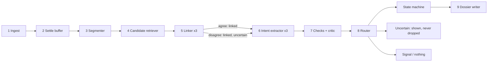

# Linking, intent detection and the user surface — proposal

Status: **decided by the user on 2026-11-15** (section 1). Numbers and thresholds are still
untested starting values.
Audience: the coding agent and the user.

This document changes three parts of the system described in
[comms-processing.md](comms-processing.md), [architecture.md](architecture.md),
[implementation-plan.md](implementation-plan.md) and [context-plan.md](context-plan.md):

1. How a message is linked to an intent across channels (architecture 3.4, 3.5).
2. How an intent is detected and checked (architecture 3.5, 3.6).
3. What the user sees and can do (architecture 3.15).

The flowcharts and one definition per agent and code stage are in
[agent-definitions.md](agent-definitions.md).

It uses the vocabulary of `comms-processing.md` (message, intent, conversation, requester,
responder, signal). Where it introduces a word, section 2 maps it to an existing one.

**Rule for the reader:** section 1 is decided. The passages of `architecture.md` and
`implementation-plan.md` that contradicted it were replaced in place on 2026-11-15, and the
original text was moved, word for word, to [superseded-2026-11-15.md](superseded-2026-11-15.md).
Do not build from that file. If anything in an older document still disagrees with section 1,
section 1 wins. `context-plan.md` and `comms-processing.md` needed no change.
`intents-use-cases.md` and the `human-interaction-*` documents were not read in full; check
them before building section 7.

---

## 0. Why

Two facts about the user's team drive every change here:

- The team does not use structure. People do not reply in Slack threads, do not distinguish To
  from CC, do not assign tickets, and follow up on a different channel from the one where the
  ask started.
- Linking and intent detection are the part that has to be right. The user prefers slow and
  correct over fast and wrong.

Consequences:

- Structural metadata (thread, CC, assignee, mention) is **weak evidence, never a gate**.
- A message cannot be understood alone. The unit of work is a **conversation window**, not a
  message.
- The system needs a memory of the team's topics before it reads its first live message.
- Errors cannot be removed. The design goal is that an error is rare, visible, cheap to undo,
  and never triggers a write by itself.

---

## 1. Decisions

Taken by the user on 2026-11-15. "Existing" is what the other documents say today.

| # | Topic | Existing | Decided | Touches |
|---|---|---|---|---|
| D1 | Dropping human messages | Triage rule 5 drops CC-only email; a small model drops what it labels noise. Principle 2: cheap first. | **Never drop.** Rules still drop automated traffic (bots, newsletters, bulk). Every human-written in-scope message reaches the linker. CC-only is a feature passed to the matcher. The small model may add flags (urgent, sensitive) but may not drop. | architecture 1.2, 3.4; impl. plan phase 2 triage |
| D2 | Unit of work | Match runs per message, with the last 5 messages of its thread. | **Conversation window.** Match runs per segment of a settled window (section 4, steps 2 and 3). | architecture 3.5; impl. plan phase 2 |
| D3 | Unclear match | Attach to the most likely intent, flag `uncertain`, let the user correct. | **Unchanged: attach to the most likely and flag it.** There is no "pending" state. Uncertain links are not excluded from context; they are marked wherever they are used (section 5). | — |
| D4 | Doubt signal | Model-reported `confidence` below 0.70 escalates a tier, then flags. | **Three runs; agreement decides**, for both the linker and the intent extractor. Model-reported confidence is logged, not used as a gate. | impl. plan 3.4 rule 7, 3.5 `confidence_floor` |
| D5 | Topics | Candidates are open and recently settled intents. | **Topic layer.** A segment links to a topic (a `workstream` in `comms_context_facts`) first, then to an intent inside it. | architecture 3.5; context-plan 3.2 |
| D6 | Backfill | 14 days, ingest and process in order, notifications suppressed. | **30 days, build everything:** topics, per-person ask patterns, labels from the user's own behaviour, open intents (section 3). | impl. plan phase 1, `backfill.days` |
| D7 | Critic | A verification pass exists only for drafts sent to others. | **Critic on every `open`, `settle` and `reopen`** before the state machine applies it. | architecture 5.2 |
| D8 | Nightly pass | Merges and splits are user actions only. | **Nightly reconciler.** Applies alone: confirming or moving uncertain links, and `settle` with a clear quote. Proposes for the user's yes: merges, splits, topic merges. Everything appears in a morning change list with evidence and undo. | architecture 3.5; context-plan Harvest |
| D9 | Slack scope | DMs, threads the user is in, mentions, channels where the user posted in the last 30 days. | **The same, plus an allow-list of channels the user picks** in settings. | impl. plan phase 1 scope |
| D10 | Home view | "waiting on me" / "I'm waiting on" / "stale". | **By who has the ball:** four groups plus a line for possible asks and uncertain links. Topic view is secondary (section 7). | architecture 3.15; impl. plan phase 2 |

Defaults taken without a separate decision; the user may overrule:

- Topics built by the backfill are used for linking from day one with `status = proposed`. The
  user confirms or corrects the list afterwards; linking does not wait for it.
- Cost is not capped in advance. It is measured during the backfill and a per-window budget is
  set then.

Not changed: the event log as source of truth, replay in `id` order, the state machine, the gate,
default policy `ask`, read-only ingestion, content-is-data (impl. plan 3.8), the quote check
("quote not in message → operation rejected").

---

## 2. Vocabulary added

| Word here | Meaning | Maps to |
|---|---|---|
| **Topic** | A subject the team keeps talking about: a project, a client, a launch. Holds many intents. | A `workstream` subject in `comms_context_facts`, plus `term` facts for the names and nicknames the team uses for it. Not a new store. |
| **Dossier** | The current written state of a topic: summary, nicknames, people, state, links to its intents and messages. | The rendered pack for one `workstream` subject (`ContextEngine::pack`). |
| **Conversation window** | The new messages in one channel or thread, plus the messages just before them, taken once the channel has been quiet for a few minutes. | New. A `window.settled` clock event in `comms_events`. |
| **Segment** | One coherent exchange inside a window, with vague references rewritten into explicit text. A window in an unthreaded channel often holds several. | New. Output of the `segment` task, stored in its `model.decided` event. |
| **Ask pattern** | How one person usually phrases an ask to the user, and on which channel. | `rule` and `person` facts with `origin = observed`. |
| **Ball holder** | Who has to act next on an intent: the user, the system, or someone else. | Derived from responders, proposals and watchers. Not a stored state. |

"Owner" in the session notes is **responder**. "FYI" is **signal**.

---

## 3. Backfill (D6)

One-off, before live processing. `php artisan comms:backfill {user} --days=30`.

Ingestion is as in impl. plan phase 1: in scope, in `occurred_at` order, `normalized.backfill = true`,
no `now` notifications. On top of that, five passes over the backfilled log, in this order:

| # | Pass | Kind | Output |
|---|---|---|---|
| B1 | Identity | code + model for the leftovers | `person.identified` events. The user confirms the merged list once. Display name alone still never merges. |
| B2 | Topic builder | model | Clusters backfilled conversations into topics. For each: `workstream` facts (what, with whom, where, state) and `term` facts (every name the team uses for it). `origin = inferred`, `status = proposed` until the user confirms the list. |
| B3 | Ask patterns | model | Per person with enough traffic: how they ask the user for things and where. `rule` facts, `origin = observed`. |
| B4 | Label miner | code | For every backfilled incoming message: did the user reply, act (ticket moved, event created, file shared) or ignore it within N days. Written to the golden set as weak labels. |
| B5 | Open-intent sweep | the live pipeline (section 4) | Runs the normal pipeline over the 30 days. Intents still open at the end appear in the list with the "from before activation" marker. |

Rules:

- 30 days is a starting window, not a boundary. When a live segment refers to something that
  matches no topic and no intent, the history fetch (section 6) searches further back.
- B2 to B4 produce context facts only through events, as `context-plan.md` requires.
- **Evaluation built in:** run B1 to B4 on days 1 to 21. Run the live pipeline on days 22 to 30.
  Compare the intents it opens and the ones it marks as needing the user against B4's labels for
  those days. This is the first number for misses and false asks, before anything goes live.

---

## 4. Live pipeline for linking and intent detection

Runs per conversation window, serialized per user as today. Steps marked **code** call no model.
Steps marked **agent** are model calls with **no tools** and a schema. Nothing in this section
can call a write tool.



### Step 1 — Ingest (code)

As today, with two changes. D1: no human-written in-scope message is dropped before step 5;
automated traffic is still dropped or allow-listed by rule. D9: Slack scope is the existing scope
plus `scope.slack.extra_channels`, a list the user edits in settings; a change is a
`user.configured` event and applies to new messages only (the backfill reads the list as it is
when it runs).

### Step 2 — Settle buffer (code)

- Group incoming messages by `(source, channel or thread_ref)`.
- When a group has had no new message for `settle.quiet_minutes` (default 5), or has been open
  for `settle.max_minutes` (default 20), append a `window.settled` clock event listing the new
  message ids. This event, not the messages, moves the pipeline forward, so replay is
  deterministic.
- The window given to step 3 is those messages plus the previous `window.lookback_messages`
  (default 30) in the same channel, capped by `window.lookback_hours` (default 48).
- Messages flagged urgent by rule (production keywords from an owned area, DM from a person with
  weight ≥ 35) skip the wait: window settles immediately.
- DMs and real threads use the same step with a shorter quiet time (default 2).

### Step 3 — Segmenter (agent, task `segment`)

Input: the window, each message with author, time and id; the people table entries for the
authors.

Output, per segment:

- `message_ids` — which messages belong to it. A message may be in two segments.
- `new_message_ids` — which of those are new in this window.
- `restated` — the exchange rewritten so it stands alone: every "that", "it", "the thing from
  yesterday", "what we said" replaced by what it refers to, when the window makes that clear.
- `unresolved_refs` — references it could not resolve from the window.
- `participants`.

Segments with no new message are discarded. `unresolved_refs` is passed forward; it is what
triggers the history fetch.

### Step 4 — Candidate retriever (code)

For each segment, in this order:

1. **Hard links.** Thread ref already linked to an intent; ticket keys, page ids, PR numbers and
   URLs found in the text; reply headers. A hard link is a candidate with a marker, not an
   automatic attach: an old thread can carry a new ask.
2. **Topic candidates.** Keyword search and embedding search over dossiers, using `restated`
   and the topic's `term` facts. Merged by rank, then reranked.
3. **Intent candidates.** As today (shared participant, linked ticket, embedding similarity to
   `what`), plus every open intent inside the top topic candidates.

Return up to `candidates.max` (10) topics and 10 intents. Store the ids in the decision inputs,
as today.

Measure this step alone: for golden-set segments, is the correct topic and intent in the list?
If retrieval misses, nothing downstream can recover.

### Step 5 — Linker (agent, task `link`, 3 runs)

Input: the segment (`restated` and the raw messages), the candidate dossiers and intents, the
authors' ask patterns, and up to `examples.max` (5) corrections from the golden set that involve
the same people or topics.

Each run sees the candidates in a different shuffled order. Position in the list changes what a
model selects, so the order must not be constant.

Output: one of

- `topic(topic_id)` and, inside it, `intent(intent_id)` or `no_existing_intent`
- `new_topic(name, why)`
- `ambiguous(a, b)` — two candidates fit and the text does not decide
- `none` — belongs to no topic worth tracking

plus the quote that justifies the choice.

Decision (code). No segment is left unplaced (D3):

- 3 of 3 agree → linked (or `none`, if that is what all three say).
- Otherwise → linked to the **most likely** choice, marked `uncertain`. Most likely is, in
  order: the choice made by 2 of 3 runs; else the existing candidate chosen by any run that
  ranks highest in the retriever's list; else `new_topic` / `no_existing_intent`.
- An `ambiguous(a, b)` answer counts as a vote for `a`. The prompt asks for the more likely one
  first. `b` is stored as the alternative and offered to the user on the card ("¿Es esto?").

An uncertain link is re-examined by the nightly reconciler (section 6), which confirms it or
moves it.

A wrong merge is worse than a wrong split: it puts the wrong context into a draft. When the
runs do not agree on an existing intent, the tie-break above still prefers an existing candidate
because D3 says attach; the protection is the marker (section 5), not avoidance.

### Step 6 — Intent extractor (agent, task `match`, 3 runs)

Keeps the existing operation set (impl. plan 3.6): `attach`, `open`, `settle`, `reopen`,
`update`, `acknowledge`, `signal`, `noise`.

Input: the segment, the linked dossier, the open and recently settled intents of that topic, the
authors' ask patterns, the user's identity, today's date in the user's time zone.

For `open`, the fields are:

| Field | Notes |
|---|---|
| `kind` | request, commitment, question, decision_needed. (A signal is the `signal` operation.) |
| `what` | One sentence, as an outcome. |
| `requesters`, `responders` | Person ids. `possible_responder` for group asks. `unclear` is allowed. |
| `steps` | Optional. Ordered list. Each step: what, `after` (ids of steps it waits for), `condition` (text, e.g. "if a slot is found"). Steps with the same `after` run in parallel. Only what the message itself implies; the playbook plans the rest. |
| `deadline` | Resolved date plus the original text, as today. |
| `expects` | What would settle it, as today. |
| `quote` | Exact text from a message in the segment. |

Decision (code): the three runs are compared on operation type, target intent, and for `open`
on `kind`, responders and deadline date. `what` is compared by embedding similarity, not text.

- All agree → go to step 7.
- Disagree on whether there is an ask at all → `uncertain`; shown to the user as a possible ask.
- Agree there is an ask, disagree on a field → the field is `unclear`, the intent opens, the
  card shows the field as a question.

Replay: each run is its own `model.decided`, keyed by `(task, input_event_ids, prompt_version,
run_index)`. The existing key needs `run_index` added.

### Step 7 — Checks and critic (code, then agent, task `critic`)

Code checks, all must pass:

- `quote` appears word for word in a message of the segment. (Existing rule.)
- Every person id exists.
- `deadline` parses and is not before the message.
- `settle` targets an open intent; `reopen` targets a settled one. (Existing state machine rule.)

Critic: a separate prompt, given only the proposed operation, the raw messages and the dossier.
Its job is to refute. It answers three questions with a quote each:

1. Is this actually asking the user (or promised by the user), or someone else?
2. Has it already been done or answered, in this window or in the dossier?
3. Is it a real ask, or conversational ("we should grab a coffee")?

A refutation with a valid quote turns the operation into `uncertain`. A refutation without a
valid quote is ignored and logged.

The critic runs on `open`, `settle` and `reopen`. Not on `attach` or `acknowledge`.

### Step 8 — Router (code)

| Linker | Extractor + critic | Result |
|---|---|---|
| linked | all agree, critic passes | Operations go to the state machine. |
| linked | disagreement or critic objects | Applied as `uncertain`. Shown under "possible asks" with the quote. No playbook runs on it. |
| linked, uncertain | all agree, critic passes | Operations go to the state machine. The link carries `uncertain`; the intent itself is not a "possible ask". Playbooks may run. |
| linked, uncertain | disagreement or critic objects | Applied as `uncertain`. Shown under "possible asks". No playbook runs on it. |
| any | `signal` or `noise` | Signal recorded on the topic, or nothing. Dossier still updated. |

Nothing human-written is ever silently dropped: it ends as an intent operation, a signal, an
uncertain item, or a line in the topic digest.

Two kinds of doubt, kept apart:

- **Uncertain intent** ("possible ask"): the system is not sure there is an ask. No playbook,
  no proposal, until the user confirms.
- **Uncertain link**: there is an ask or an update, but it may be attached to the wrong intent.
  Per D3 it is used as context. It is marked wherever it is used (section 5).

### Step 9 — Dossier writer (agent, task `dossier_write`)

After the state machine applies a window, rewrites the topic's `summary` and state facts from
the previous dossier plus what changed. Emits `context.*` events; the projector writes the facts.
Output is a short diff ("deadline moved to Friday; Marta took over from Dani"), which is also
what the surface shows as "changed since you last looked".

### Model tiers and config

Slow and correct: use the strongest available tier for `link`, `match` and `critic`.

```php
'tasks' => [
    'segment'       => ['tier' => 'mid',   'fallback' => 'large', 'prompt' => 'v1'],
    'link'          => ['tier' => 'large', 'fallback' => null,    'prompt' => 'v1', 'runs' => 3],
    'match'         => ['tier' => 'large', 'fallback' => null,    'prompt' => 'v2', 'runs' => 3],
    'critic'        => ['tier' => 'large', 'fallback' => null,    'prompt' => 'v1'],
    'dossier_write' => ['tier' => 'mid',   'fallback' => 'large', 'prompt' => 'v1'],
    'reconcile'     => ['tier' => 'large', 'fallback' => null,    'prompt' => 'v1'],
],
```

| Key | Default | Used by |
|---|---|---|
| `settle.quiet_minutes` | 5 (2 for DMs and threads) | Step 2 |
| `settle.max_minutes` | 20 | Step 2 |
| `window.lookback_messages` | 30 | Step 2 |
| `window.lookback_hours` | 48 | Step 2 |
| `agreement.runs` | 3 | Steps 5, 6 |
| `examples.max` | 5 | Step 5, 6 prompts |
| `backfill.days` | 30 | Section 3 |
| `reconcile.time` | 03:00 user time | Section 6 |

**All of these numbers are starting guesses.** None has been tested. The backfill evaluation in
section 3 is where they get tuned. `budget.per_message_tokens` (30 000) will be too low for a
window processed with 3 + 3 + 1 large calls; set a `budget.per_window_tokens` after measuring.

---

## 5. How errors are contained

| Error | What limits it |
|---|---|
| Retrieval misses the right topic | Measured separately (step 4). Hard links first. Keyword and embedding search together. Nicknames stored as `term` facts. History fetch for unresolved references. |
| Wrong merge (message attached to the wrong intent) | Three shuffled runs must agree, or the link is marked `uncertain`. Uncertain links are marked on the card, in the conversation, and in every draft that used them (below). Links are a separate layer over an immutable log, so a re-match is a correction event, not a data fix. Nightly reconciler confirms or moves every uncertain link of the day. |
| Wrong split (duplicate intent) | Nightly reconciler proposes the merge. One-tap "same". |
| Missed ask | No model may drop human traffic. Disagreement shows the item instead of hiding it. B4 labels and the user's later manual attaches count misses. |
| False ask | Critic. Shown as "possible ask", never acted on. One-tap "not for me" becomes an example. |
| Confident and wrong | Self-reported confidence is not a gate. Agreement and the critic are. |
| Instructions inside a message | Existing 3.8. In addition: steps 3 to 7 have no tools at all; playbooks receive the structured intent and cited quotes; uncertain intents cannot produce a proposal. |
| The same mistake twice | Every correction is an event, goes to the golden set, and is retrieved as an example for the same people or topic. |

**Uncertain links in drafts (consequence of D3).** A draft may be built on a message that is
attached to the wrong intent. To keep that visible:

- The context engine returns each message with its link state. A proposal records which of its
  sources came through an uncertain link.
- The approval card shows, above the draft: "Uses 1 message that may belong elsewhere", with
  the quote and "¿Es esto?" (confirm / move). Confirming or moving is one tap and happens before
  approving.
- If the user moves the message, the draft is regenerated.
- An action class set to `allow` is still asked when its proposal rests on an uncertain link.
  Nothing is sent alone on doubtful context.

What "perfect" means here: not zero errors. It means nothing is lost, every link and every
intent shows the quote it rests on, doubt is shown as doubt, and a correction sticks.

---

## 6. Nightly reconciler and learning loop (D8)

Runs at `reconcile.time`. Extends the Harvest producer in `context-plan.md`.

1. **Reconciler** (agent, task `reconcile`, per topic touched that day). Reads the topic's day
   in full, with the dossier. Proposes:
   - `merge(intent_a, intent_b)` — same need opened twice.
   - `split(intent, message_ids)` — messages that belong elsewhere.
   - `settle(intent, reason, quote)` — resolved on another channel, or taken by someone else.
   - `confirm_link(message_ids, intent)` — an uncertain link that the rest of the day supports.
   - `relink(message_ids, from_intent, to_intent or new)` — an uncertain link that belongs elsewhere.
   - `merge_topics(a, b)` — two topics that are one.
2. **History fetch** (code). For each `unresolved_ref` and each `new_topic` of the day, search
   the sources beyond the backfill window. Hits are ingested as backfill and the segment retried.
3. **Apply.**
   - Applied automatically, reported with undo: `confirm_link` and `relink` of links that were
     already `uncertain`; `settle` with a valid quote that passes the critic.
   - A `relink` of a link that was **not** uncertain is a split: proposed, not applied.
   - Proposed, applied only when the user accepts: merges, splits, topic merges.
   - The user may later move a class from "proposed" to "automatic" when its acceptance rate
     is high enough. Default is the list above.
4. **Change list.** One item in the morning digest: every change with its quote. Each line has
   "same" / "not the same" / "undo".
5. **Golden set.** Every answer is a `user.corrected` event. The golden set is the union of:
   the fixed golden sequences (impl. plan), B4's weak labels, and corrections.
6. **Weekly eval** (code). Replays the golden set. Reports separately:
   - retrieval: correct topic in top 10, correct intent in top 10
   - linking: precision of attaches, share uncertain, share of uncertain links later moved
   - intents: precision and recall of "needs the user", against corrections and B4 labels
   - corrections per 100 in-scope human messages (existing metric)
   A prompt or model change ships only if none of these gets worse.

---

## 7. The user surface (D10)

Written for a manager who has to see what is going on at a glance.

### 7.1 What is shown

**The user never sees a message as an item. The item is the intent.**

- **Topic** — the container.
- **Intent** — the card. Its title is `what`, an outcome: "Confirm the new launch date with
  Marta". Never a message subject.
- **Messages** — evidence inside the card, across channels, in time order.
- Messages that open or change no intent are not listed. They roll up into one line per topic
  in the digest: "Pricing: 14 messages, nothing for you."
- **Signals** attach to the topic or intent they change and are surfaced as the existing
  documents say.

### 7.2 Home: who has the ball

Four counters at the top, each opens its list:

| Group | Contains | Derived from |
|---|---|---|
| **Needs you** | Proposals to approve, decisions, questions from the system, outcomes to confirm, intents where the user is responder and nothing is drafted. | user is responder with no executed action; pending `Proposal` or `Question` |
| **System working** | A playbook run in progress. | `PlaybookRun` active |
| **Waiting on others** | The user or the system asked; no answer yet. Shows who and for how long. | user is requester, or a watcher is waiting |
| **Done today** | Settled today, including what the system did alone. Each line undoable where the action allows. | `settled` today, `action.executed` today |

Below "Needs you": one line, "N possible asks, M uncertain links". Opens the two lists.
Possible asks are intents the system is not sure exist. Uncertain links are messages that may
be attached to the wrong intent; each row shows the quote, where it was put, the alternative
if there is one, and "¿Es esto?" (confirm / move). Cards with an uncertain link also show the
marker in place.

Stale stays as today: a batch, asked once.

Ordering inside a group: importance (existing calculator), then deadline.

Secondary view: by topic. For reviewing one project in depth. Same cards.

This replaces the three groups in impl. plan phase 2. "Esperan algo de mí" is "Needs you",
"Espero algo de otros" is "Waiting on others", "Sin movimiento" is the stale batch.
Suggested Spanish labels: "Te toca", "En marcha", "Esperando a otros", "Hecho hoy".

### 7.3 The intent card

Collapsed (in a list): `what` · topic · channel icons · who is waiting on whom · deadline ·
one status pill ("Approve 2", "Your decision", "Confirm outcome", "Updated 4 min ago").

Open:

1. `what`, requester, responder, topic, deadline.
2. **Changed since you last looked** — one sentence from the dossier writer's diff. Only when
   something changed after the user last opened the card.
3. **Plan** (7.5).
4. **Actions** (7.7).
5. **Evidence** — the quote, and "N messages on M channels" which expands to the conversation.

Unclear fields are shown as a question in place of the value ("Who should do this?").

### 7.4 When a new message arrives on an existing intent

The card is never duplicated. It moves up and gets the "updated" pill.

| What the message did | Operation | What the user sees |
|---|---|---|
| Added information | `attach` | "Changed since…" line. Plan updated silently. |
| Changed the ask (deadline, responder, scope) | `update` | Plan remade. Any proposal approved but not yet executed returns to "Needs you" with what changed. Executed steps are not redone; if one is now wrong, a question says so. |
| Answered or delivered, on any channel | `settle` | Card moves to "Done today" with the reason and an undo. |
| Acknowledged only ("ok", 👍) | `acknowledge` | Still open. If it is unclear whether that settles it, a "Confirm outcome" card. |
| Withdrew or contradicted it | `settle` (withdrawn) or `update` | Any running playbook stops. Card to "Needs you" only if something was already sent. |
| Came back after settling | `reopen` | Card returns to its group with "reopened" and the reason. |

Interrupts follow the notifier (architecture 3.14). A card changing does not by itself notify.

### 7.5 How the plan is shown

A checklist inside the card. Not a diagram.

- Sequential steps top to bottom.
- Parallel steps side by side under "Then, at the same time".
- Conditions in words at the start of the step: "If Marta confirms: create the event".
- Each step shows: status (done, running, needs approval, waiting on someone, blocked,
  skipped), the channel or tool it touches, and a preview of exactly what will be sent or
  changed (the draft text, "due date Mar 14 → Mar 12").
- A step waiting on a person shows who and since when.
- Sources for any stated fact are one tap away (architecture principle 5).

Source of the steps: the intent's `steps` (step 6) plus what the playbook run adds
(`PlaybookRun`, `Proposal`, `IntentWatcher`).

### 7.6 Confirmations

Three kinds only. Each is one card, answerable in one tap or one spoken sentence.

| Kind | When | Buttons |
|---|---|---|
| **Approve an action** | Before a write the policy does not allow alone. Parallel steps can be approved together. | Approve · Edit · Guide (voice) · Reject |
| **Disambiguate** | An uncertain link ("¿Es esto?"), or an unclear field. | Confirm · the alternative · "Somewhere else" |
| **Confirm an outcome** | A closing signal that is not clear ("ok", a 👍, silence after delivery). Clear ones close alone with an undo. | Done · Still open |

Voice: "sí" confirms the open proposal, as today. Any other sentence is guidance: the system
redrafts and shows the new version.

### 7.7 Actions on an intent

| Action | Effect | Event |
|---|---|---|
| Approve / edit / reject a proposal | As today, through the gate. | existing |
| Guide by voice | New instruction for the playbook run; redraft. | `user.guided` |
| Not for me | Settles for the user. Becomes an example for the critic. | `user.corrected` |
| Delegate to a person | Responder changes; system proposes the message to that person; card moves to "Waiting on others". | `update` + proposal |
| Snooze until | Hidden from "Needs you" until then. Deadline still counts. | `user.snoozed` |
| Merge with / split | As today. | `user.corrected` |
| Move to another topic or intent (re-match) | As today. | `user.corrected` |
| Mark done / still open | As today. | `user.corrected` |
| Change importance | As today (30-day override). | `user.corrected` |
| Always do this without asking | Sets policy `allow` for that action class and context. Hard denies still apply. | `user.configured` |
| Undo | For executed actions that recorded an undo. | existing |

### 7.8 Use cases the surface must handle

Each maps to cases in `intents-use-cases.md`; verify the numbers against that file.

1. A direct ask to the user → card in "Needs you" with a draft.
2. The same ask on two channels → one card, both sources (case 10).
3. Scheduling → plan with a condition; approve once.
4. A status question the sources can answer → answered draft with citations (cases 9, 19).
5. A decision is needed → options and context on the card; the user picks (case 23).
6. The user promises something → intent with the user as responder (cases 7, 8).
7. The user asked and nobody answered → "Waiting on others" with age; a nudge is proposed (case 5).
8. A deadline is close and the ball is with someone else → moves up; one alert (cases 16, 24).
9. Resolved elsewhere → closes alone, "Done today", undo (case 15).
10. Morning briefing by voice → what changed overnight, what needs the user, the reconciler's
    change list.
11. Audit → "Done today": what the system did alone.
12. "What is going on with X?" → the topic view: open intents by ball holder, last changes.

---

## 8. Build order

Fits inside the existing phases. Nothing here adds a second way for a message to become an intent.

| Step | What | Where it lands |
|---|---|---|
| 1 | Done 2026-11-15: contradicting passages of `architecture.md` and `implementation-plan.md` replaced; originals in `superseded-2026-11-15.md`. | — |
| 2 | Backfill to 30 days; passes B1, B4. | Phase 1 |
| 3 | `window.settled`, settle buffer, `segment` task. Matching consumes segments. Golden sequences for unthreaded channels. | Phase 2 |
| 4 | Topics as `workstream` facts; pass B2; candidate retriever over topics; `link` task with 3 runs; most-likely tie-break; Slack extra-channel allow-list in settings. | Phase 2 + context-plan C1 |
| 5 | `match` v2 with 3 runs, `critic`. Backfill evaluation (section 3). **Gate:** do not go further until the numbers are written down and the user accepts them. | Phase 2 gate |
| 6 | Home by ball holder, card, "changed since", possible asks and uncertain links lists. | Phase 2 |
| 7 | Dossier writer; pass B3; examples from the golden set in prompts. | Phase 2/5 |
| 8 | Nightly reconciler, history fetch, change list, weekly eval. | Phase 3 |
| 9 | Plan checklist, three confirmation kinds, uncertain-source notice on approval cards, delegate, snooze, "always do this". | Phase 4 |

New golden sequences needed, on top of the existing table:

| Fixture | Expected |
|---|---|
| Unthreaded channel, two conversations interleaved | Two segments; each linked to its own intent |
| "¿viste eso?" with the referent 12 messages earlier | `restated` names the referent; linked |
| Same ask in Slack, then follow-up by email with no reference | One intent; second channel attached |
| Follow-up that fits two open intents equally | Attached to the more likely, `uncertain`, alternative stored; row in uncertain links |
| Later message that day shows the uncertain link was wrong | Reconciler `relink`; applied; in change list with undo |
| Draft built on an uncertain link | Approval card shows the notice; action class on `allow` still asks |
| Message in a channel on the user's extra allow-list, no mention | Ingested and processed |
| "we should grab a coffee sometime" | No intent; critic refutes |
| CC-only email that does contain an ask for the user | Intent opened (D1) |
| Ask answered on another channel by a third person | Settled by reconciler; in change list with undo |
| Same need opened twice during the day | Reconciler proposes merge; applied on accept |
| Reference to a topic older than the backfill window | History fetch ingests it; segment linked |
| Three runs disagree on whether there is an ask | Uncertain; listed as possible ask; no playbook |
| Deadline changes after a reply was approved but not sent | Proposal returns to "Needs you" with the change |

---

## 9. Still open

1. **Cost.** Three large-tier runs for linking, three for extraction and one critic per window is
   several times today's per-message cost, and D1 and D9 raise the number of windows. Unknown
   until the backfill is measured.
2. **Who skips the settle wait.** Which senders or keywords count as urgent by rule.
3. **Which channels go on the Slack allow-list** (D9). The user's list.
4. **Thresholds.** Every number in section 4 is a starting value.
5. **Promotion.** When a class of reconciler proposal (merge, split) may move to automatic.

---

## 10. Sources behind the design choices

- Candidate filtering before matching, and selecting among candidates instead of pairwise
  yes/no; position in the list affects the choice: [Match, Compare, or Select? LLMs for Entity Matching](https://arxiv.org/html/2405.16884v1)
- Keyword plus embedding search with context-enriched chunks and reranking: [Contextual Retrieval, Anthropic](https://anthropic.com/research/contextual-retrieval)
- Thread disentanglement as link prediction plus clustering; forced links break clusters when a
  message starts a conversation: [Findings on Conversation Disentanglement](https://arxiv.org/pdf/2112.05346), [pointer-network disentanglement](https://web3.arxiv.org/pdf/2403.05931)
- Standard disentanglement metrics did not reflect human satisfaction, so the user's own
  corrections are the metric: [Dialogue Disentanglement in Software Engineering](https://arxiv.org/abs/2105.08887v1)
- Self-reported model confidence is overconfident; agreement across runs is a better signal:
  [Calibrating Verbalized Confidence with Self-Generated Distractors](https://arxiv.org/pdf/2509.25532)
- Commitment detection in email as a defined task: [Smart To-Do](https://arxiv.org/pdf/2005.06282)

The disentanglement research is mostly on IRC and technical chat, not workplace traffic across
several tools. Treat it as direction, not as expected accuracy.
