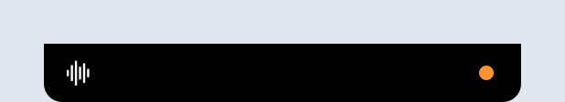
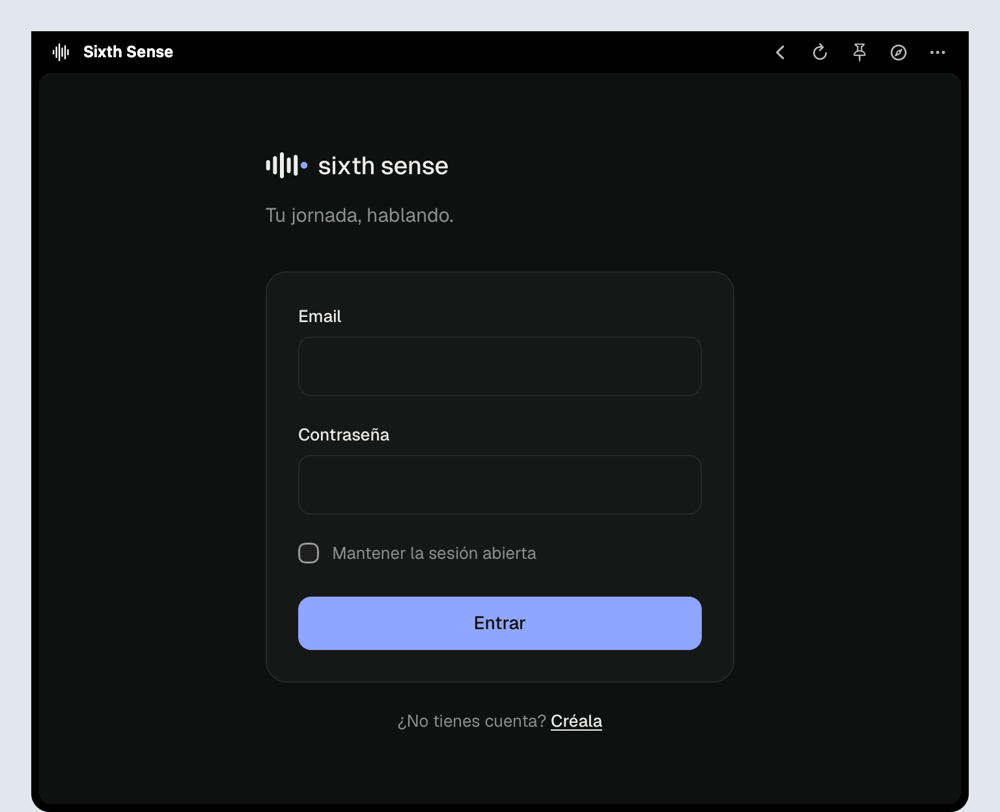

# Sixth Sense in the notch

A small macOS app that keeps sixth-sense one shortcut away. It lives in the notch: press **⌥ Space** from any app, or click the notch, and the assistant drops down. Click outside and it folds back.

<p align="center">
  
  <br>
  
</p>

## What it does

- **⌥ Space** opens and closes it from anywhere. So does a click on the notch, or opening the app again.
- **Folding does not reload the page.** The conversation and the voice keep going.
- **An orange dot** next to the notch while the assistant is using the microphone, even when it is folded.
- **The pin** keeps it open while you work in another app.
- **No notch** (an external display only): it moves to a menu bar icon with the same panel.
- **The session is kept** between launches. Links that open a new tab go to your browser.
- **The microphone** is granted only to your own instance, so it does not ask every time.

## Build it

It needs macOS 14 or later and the Xcode Command Line Tools (`xcode-select --install`). Full Xcode is not needed.

```bash
cd extensions/macos-notch
scripts/build-app.sh
```

That leaves a universal `build/Sixth Sense.app` (Apple silicon and Intel). Move it to Applications and open it. It is signed ad hoc and not notarized, so the first time macOS asks you to confirm: right-click the app, then **Open**.

## Point it at your server

It opens `https://sixth-sense.on-forge.com` by default. To use your own instance, open the panel and go to **⋯ → Servidor…**. Or from the terminal:

```bash
defaults write io.github.johnleonkab.sixth-sense.notch url https://your-server/login
```

The panel size can be changed the same way, with `width` and `height` in points (720 × 600 by default). Quit and reopen the app after changing them.

## How it is built

Swift, AppKit and WebKit, with no dependencies. The page runs in a `WKWebView` that stays alive while the panel is folded. The shortcut uses Carbon's global hot keys, so it needs no Accessibility permission.

`SixthSenseNotch --render <folder>` loads the page off screen and writes the folded and open notch as PNGs. That is how the screenshots above were made.
